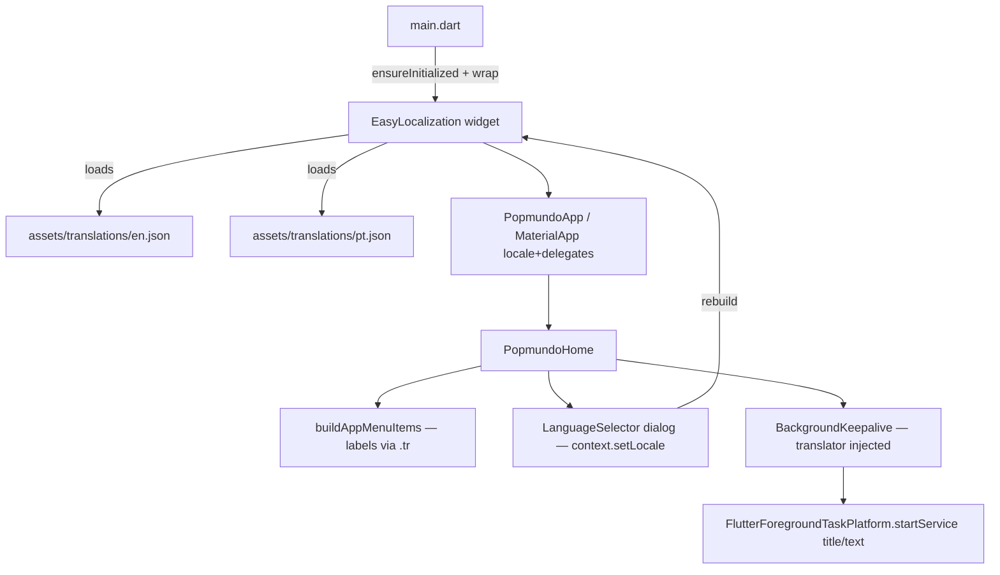

# App Shell Internationalization (EN + PT) Design

**Spec**: `.specs/features/app-i18n/spec.md`
**Status**: Approved

---

## Architecture Overview

easy_localization wraps the existing widget tree at the composition root; every release-visible shell string resolves from JSON catalogs bundled as assets. No new state management — the library owns locale state and persists the choice in shared_preferences. The keepalive layer receives translated notification strings through an injected translator so `popmundo_utils`/`popmundo_webview` stay untouched (AD-002).



Locale data flow: device locale (first run) or saved locale → `EasyLocalizationController` → `context.locale` → MaterialApp rebuilds → every `.tr()` re-resolves. `context.setLocale(Locale)` mutates the controller (async, persists when `saveLocale: true`).

**Verified API surface (easy_localization 3.0.8, checked against canonical `public_ext.dart` source):**
- `EasyLocalization.ensureInitialized()` before runApp
- `EasyLocalization(supportedLocales, path, fallbackLocale, useOnlyLangCode, useFallbackTranslations, saveLocale, startLocale, child)`
- `BuildContextEasyLocalizationExtension`: `context.locale` (getter), `Future<void> context.setLocale(Locale)` (modern), `context.supportedLocales`, `context.localizationDelegates`, `context.deviceLocale`, `context.resetLocale()`. NOTE: the `context.locale = x` setter is **@Deprecated** — do not use.
- `String.tr({args, namedArgs, gender})` — resolves through the global `EasyLocalizationController` singleton, so it also works outside widget build methods once catalogs are loaded (this is what lets `buildAppMenuItems` stay context-free).

---

## Code Reuse Analysis

### Existing Components to Leverage

| Component | Location | How to Use |
| --------- | -------- | ---------- |
| `buildAppMenuItems` registry | `lib/menu/app_menu_registry.dart` | Add `onOpenLanguage` + one `AppMenuItem`; labels switch to `.tr()` — sidebar stays untouched (renders `item.label`) |
| `AppMenuItem` value object | `lib/menu/app_menu_item.dart` | Unchanged — `label: String` resolved at registry build time |
| `BackgroundKeepalive` orchestrator | `lib/background/background_keepalive.dart` | Add optional `translator` ctor param; pass resolved strings to `startService` |
| `BackgroundPlatform` interface | `lib/background/background_platform.dart` | `startService` gains `notificationTitle`/`notificationText` params |
| `FakeBackgroundPlatform` | `test/fake_background_platform.dart` | Capture the new params for assertions |
| `platform_config_test.dart` pattern | `test/platform_config_test.dart` | Same file-content assertion style for `CFBundleLocalizations` |
| shared_preferences (already a dep) | pubspec | easy_localization's own persistence backend — no new persistence mechanism |

### Integration Points

| System | Integration Method |
| ------ | ------------------ |
| easy_localization 3.0.8 | Widget wrapper at composition root (`main.dart`) + extension API in UI; depends transitively on `shared_preferences` (already present), `flutter_localizations`, `intl` |
| Android FGS (`flutter_foreground_task`) | Unchanged API — only the string values passed to `startService` become translated |
| iOS | `CFBundleLocalizations` array added to Info.plist (documented requirement of the library) |

---

## Components

### Translation catalogs

- **Purpose**: Single source of truth for every release-visible shell string, per language.
- **Location**: `apps/popmundo_app/assets/translations/en.json`, `pt.json` (directory declared once in pubspec `flutter.assets`).
- **Schema**: nested JSON, dot-accessed namespaces:

```json
{
  "app":   { "title": "..." },
  "common":{ "cancel": "...", "delete": "...", "save": "...", "import": "...", "url": "URL" },
  "menu":  { "autoLogin": "...", "autoLoginSubtitle": "...", "userscripts": "...",
             "userscriptsSubtitle": "...", "debugPanel": "...", "debugPanelSubtitle": "...",
             "language": "...", "languageSubtitle": "...", "empty": "..." },
  "language": { "dialogTitle": "..." },
  "userscripts": { "title": "...", "add": "...", "empty": "...", "imported": "Imported '{}'",
                   "deleteTitle": "...", "deleteConfirm": "Delete '{}'? This cannot be undone." },
  "autologin": { "title": "...", "enabled": "...", "enabledSubtitle": "...", "username": "...",
                 "password": "...", "passwordKeep": "...", "passwordRequired": "...",
                 "clearPassword": "...", "character": "...", "characterHelp": "...",
                 "status": "...", "saved": "...", "saveFailed": "Save failed: {}",
                 "statusNormal": "...", "statusBusy": "...", "statusMobile": "...",
                 "statusAway": "...", "statusDrunk": "..." },
  "keepalive": { "notificationTitle": "...", "notificationText": "..." }
}
```

- Interpolation uses easy_localization positional `{}` via `.tr(args: [...])` (imported script name, deleted script name, save error). Option labels in the language dialog are **endonyms** ("English", "Português") — identical in both catalogs by design.
- **Dependencies**: loaded by `RootBundleAssetLoader` (library default).

### Locale bootstrap (composition root)

- **Purpose**: Initialize the library and expose locale to MaterialApp.
- **Location**: `lib/main.dart` (modify), `lib/app.dart` (modify).
- **Interfaces**:
  - `main()`: `WidgetsFlutterBinding.ensureInitialized()` → `await EasyLocalization.ensureInitialized()` → existing keepalive/prefs wiring → `runApp(EasyLocalization(supportedLocales: [Locale('en'), Locale('pt')], path: 'assets/translations', useOnlyLangCode: true, fallbackLocale: Locale('en'), useFallbackTranslations: true, child: PopmundoApp(...)))`
  - `PopmundoApp.build`: `MaterialApp(localizationsDelegates: context.localizationDelegates, supportedLocales: context.supportedLocales, locale: context.locale, title: 'app.title'.tr(), ...)`
- **Reuses**: existing composition-root ordering (AD-002); `FlutterForegroundTask.initCommunicationPort()` stays before the wrapper.

### LanguageSelector

- **Purpose**: Sidebar dialog to switch between EN and PT.
- **Location**: `lib/language/language_selector.dart` (new).
- **Interfaces**:
  - `const List<Locale> supportedAppLocales = [Locale('en'), Locale('pt')]` — also consumed by the EasyLocalization wrapper (single source of truth, exported from `app.dart` import or a shared const file — implementer picks the import direction that avoids cycles; the wrapper in `main.dart` may import it)
  - `Future<void> showLanguageDialog(BuildContext context)` — `AlertDialog` (key `language-dialog`) with one `RadioListTile` per locale (keys `language-option-en`, `language-option-pt`), groupValue `context.locale.languageCode`, labels = endonyms; on select: `await context.setLocale(locale)` then `Navigator.pop`. Re-selecting the active locale just pops (idempotent, I18N-03 AC4).
- **Dependencies**: easy_localization extension; Material.
- **Reuses**: dialog patterns from `userscripts_screen.dart` (`showDialog` + keys on every interactive element).

### Menu registry extension

- **Purpose**: Surface the Language entry; localize all item labels.
- **Location**: `lib/menu/app_menu_registry.dart` (modify).
- **Interfaces**: `buildAppMenuItems({…, required VoidCallback onOpenLanguage})` returns items with `label: 'menu.X'.tr()`, `subtitle: 'menu.XSubtitle'.tr()`; language item `id: 'language'`, `icon: Icons.language`, always visible (before the debug-gated item).
- **Why static `.tr()` is safe here**: resolved through `EasyLocalizationController` singleton; the registry is only ever called from `PopmundoHome.build`, which exists only after catalogs loaded.

### Keepalive translation injection

- **Purpose**: Localize FGS notification title/text without coupling the background layer to easy_localization.
- **Location**: `lib/background/background_platform.dart`, `background_keepalive.dart`, `flutter_foreground_task_platform.dart`, `keepalive_task_handler.dart` (untouched).
- **Interfaces**:
  - `BackgroundPlatform.startService({required String notificationTitle, required String notificationText})`
  - `BackgroundKeepalive({…, String Function(String key)? translator})`; internally `String _localize(String key, String enDefault) { final v = translator?.call(key); return (v == null || v == key) ? enDefault : v; }` — a returned-value-equals-key is treated as unresolved (covers the pre-load race, A8). Bundled EN defaults live in `background_keepalive.dart` consts.
  - Composition root passes `translator: (key) => key.tr()`.
- **Reuses**: existing bootstrap flow; no new async steps.

### Test harness

- **Purpose**: Deterministic localized pumps for all widget tests.
- **Location**: `test/localization_helpers.dart` (new).
- **Interfaces**: `Future<void> pumpLocalized(WidgetTester, Widget child, {Locale startLocale = const Locale('en'), Locale? setLocaleAfterLoad})` — `TestWidgetsFlutterBinding.ensureInitialized()` + `SharedPreferences.setMockInitialValues({})` (setUpAll-safe, idempotent) + `await EasyLocalization.ensureInitialized()` + pump `EasyLocalization(supportedLocales: supportedAppLocales, path: 'assets/translations', useOnlyLangCode: true, fallbackLocale: Locale('en'), useFallbackTranslations: true, saveLocale: false, startLocale: startLocale, child: Builder(→ MaterialApp(delegates…, home: child)))` + `pumpAndSettle()`.
- **Defaults EN on purpose**: host/CI machine locale must never change test outcomes.

---

## Data Models

No new persisted domain data. Locale choice persists under easy_localization's own shared_preferences key (library-managed; `saveLocale: true` in prod, `false` in tests). Catalog JSON schema above.

---

## Error Handling Strategy

| Error Scenario | Handling | User Impact |
| -------------- | -------- | ----------- |
| Key missing in pt.json | `useFallbackTranslations: true` → en.json value | English string, never raw key |
| Key missing everywhere | Library returns key (should not happen; sweep test guards) | Flagged by tests, fixed as gap |
| Catalog asset fails to load | Library `FutureErrorWidget` | Fatal-by-design error screen (assets are bundled + test-covered; accepted) |
| SharedPreferences unavailable | saveLocale degrades silently (library catches) | Language choice not persisted; session works |
| `tr()` before load (keepalive race) | `_localize` EN-default fallback | English notification for that start |
| Unsupported device locale | `fallbackLocale: Locale('en')` | English UI |

---

## Risks & Concerns

| Concern | Location | Impact | Mitigation |
| ------- | -------- | ------ | ---------- |
| easy_localization maintenance pace (3.0.8 stable since 2025-07; 4.0.0-dev pre-releases exist) | dependency | Future migration risk | Minimal API surface used (wrapper + `tr` + `setLocale` + 3 context getters); swap cost low; recorded in AD-014 |
| Host machine locale leaking into tests | every widget test | Flaky/red tests on pt machines | Harness forces `startLocale: en` default + `saveLocale: false` |
| Async catalog load in tests | harness | Race → raw keys asserted | `pumpAndSettle()` in harness before any finder runs |
| `buildAppMenuItems` called in plain `test()` after conversion would throw (no controller) | `test/app_menu_registry_test.dart` | Red tests | Convert registry tests to widget tests through the harness |
| Raw-key leak if a catalog key is mistyped | UI code | User sees `menu.empt` | EN/PT smoke tests + Verifier grep sweep; fallback translations only cover missing-in-pt, not missing-everywhere |
| FGS channel name not localizable post-install | Android OS | Cosmetic only | Documented (A3); title/text — the prominent parts — are localized |

---

## Tech Decisions (non-obvious)

| Decision | Choice | Rationale |
| -------- | ------ | --------- |
| i18n library | easy_localization ^3.0.8 | User-selected; verified compatible (Dart <4.0.0), MIT, asset-JSON model fits a 2-language shell; alternatives (flutter_gen l10n, slang) rejected for codegen overhead the user didn't ask for |
| One catalog per language code | `useOnlyLangCode: true` | pt-BR + pt-PT devices share `pt.json` (A1) |
| Static `.tr()` in registry | keep `AppMenuItem.label: String` | Sidebar stays context-free and dumb; controller singleton guarantees resolution after load |
| Translator injection for keepalive | ctor function param, not import | Background layer stays library-agnostic and unit-testable; EN defaults co-located with the orchestrator |
| Selector without "system default" | EN/PT only (A2) | `context.resetLocale()` exists for a future entry — deferred, not blocked |
| DebugOverlay untouched | English (A7) | User decision |

> **Project-level decision** → recorded as AD-014 in `.specs/STATE.md`: easy_localization + `assets/translations/` catalogs are the shell i18n standard; packages stay locale-free; every new release-visible shell string must go through the catalogs.
