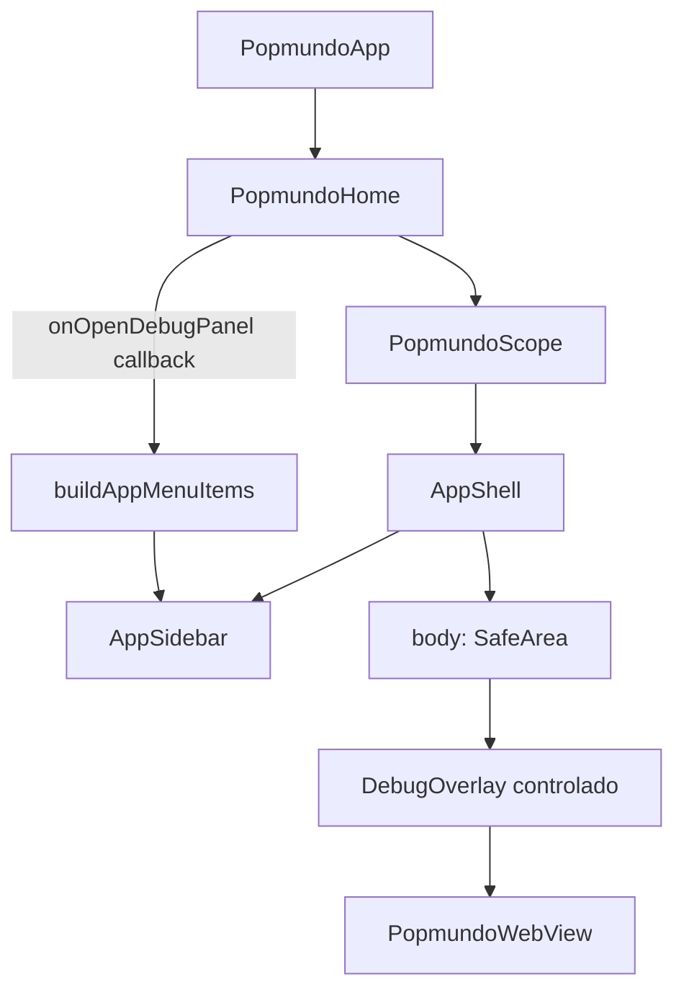

# App Sidebar Menu Design

**Spec**: `.specs/features/app-sidebar-menu/spec.md`
**Status**: Approved

---

## Architecture Overview

O app ganha uma camada de shell entre `PopmundoHome` e o conteúdo atual (`DebugOverlay` + `PopmundoWebView`). Essa camada — `AppShell` — é um `Scaffold` puro, sem dependência do runtime concreto, que hospeda um `Drawer` (`AppSidebar`) e um `FloatingActionButton` que o abre. O conteúdo do `Drawer` vem de uma lista de `AppMenuItem` produzida por uma única função de registro (`buildAppMenuItems`), que hoje devolve um item ("Debug panel") gated por `kDebugMode`.

`DebugOverlay` deixa de possuir seu próprio FAB e vira um widget controlado (`visible` + `onClose`), continuando a viver dentro do `body` do `AppShell`, empilhado com o `PopmundoWebView` exatamente como hoje — a diferença é que quem decide sua visibilidade passa a ser `_PopmundoHomeState`, acionado pelo item do sidebar.

## Code Reuse Analysis

### Existing Components to Leverage

- `apps/popmundo_app/lib/debug_overlay.dart` — `DebugOverlay`, `CookieSummary`, `_panel()`: mantidos quase intactos; apenas a fonte de visibilidade muda de estado interno (`_expanded`) para prop (`visible`).
- `apps/popmundo_app/lib/app.dart` — `PopmundoScope` (InheritedWidget) permanece intocado e sem novos call sites; `_PopmundoHomeState` ganha um campo de estado a mais.
- `packages/popmundo_utils` — nenhuma mudança; a feature é puramente Flutter-UI no app package (nenhuma lógica de host/throttle/parsing envolvida).

### Integration Points

- `_PopmundoHomeState.build()` em `app.dart` passa a compor `AppShell` no lugar do `Scaffold` inline atual.
- `AppShell` não conhece `InAppPopmundoRuntime`, `PopmundoEventBus` nem `HostTracker` — recebe apenas `items` (`List<AppMenuItem>`) e `body` (`Widget`). Isso preserva a testabilidade sem device, replicando o padrão já usado por `DebugOverlay` (props puras, harness com `PopmundoEventBus`/`HostTracker` reais, sem runtime concreto).

## Components

### AppMenuItem

- **Purpose**: Valor imutável que descreve uma entrada do sidebar.
- **Location**: `apps/popmundo_app/lib/menu/app_menu_item.dart`
- **Interfaces**:
  - `const AppMenuItem({required String id, required IconData icon, required String label, String? subtitle, required VoidCallback onTap})`
- **Dependencies**: `flutter/widgets.dart` (para `IconData`, `VoidCallback`), `flutter/foundation.dart` (`@immutable`)
- **Reuses**: nenhum — tipo novo, sem equivalente anterior no app.

### buildAppMenuItems (registry)

- **Purpose**: Única fonte de verdade da lista de itens do sidebar; ponto de extensão para novos itens.
- **Location**: `apps/popmundo_app/lib/menu/app_menu_registry.dart`
- **Interfaces**:
  - `List<AppMenuItem> buildAppMenuItems({required VoidCallback onOpenDebugPanel, bool includeDebugItem = kDebugMode})`
- **Dependencies**: `AppMenuItem`, `kDebugMode` (`flutter/foundation.dart`)
- **Reuses**: idioma de `collection-if` já usado em `debug_overlay.dart` (`if (_expanded)`, `if (widget.cookies.isNotEmpty)`).

### AppSidebar

- **Purpose**: Renderiza o conteúdo do `Drawer` a partir de uma lista de `AppMenuItem`; fecha a si mesmo ao tocar um item.
- **Location**: `apps/popmundo_app/lib/menu/app_sidebar.dart`
- **Interfaces**:
  - `const AppSidebar({required List<AppMenuItem> items})`
- **Dependencies**: `AppMenuItem`
- **Reuses**: convenção de `Key` kebab-case já usada em `debug_overlay.dart` (`debug-toggle`, `debug-panel`, ...); novas keys: `app-sidebar`, `menu-item-<id>`, `menu-empty`.

### AppShell

- **Purpose**: `Scaffold` do app: hospeda `AppSidebar` como `drawer`, o FAB que o abre, e o `body` recebido de fora.
- **Location**: `apps/popmundo_app/lib/app_shell.dart`
- **Interfaces**:
  - `const AppShell({required List<AppMenuItem> items, required Widget body})`
- **Dependencies**: `AppMenuItem`, `AppSidebar`
- **Reuses**: nenhum — primeiro `Scaffold` extraído como widget próprio no repo; antes vivia inline em `_PopmundoHomeState.build()`.

### DebugOverlay (modificado)

- **Purpose**: Mesma responsabilidade de hoje (painel de host/network/console/eval/cookies), agora como widget controlado em vez de dono do próprio toggle.
- **Location**: `apps/popmundo_app/lib/debug_overlay.dart`
- **Interfaces** (novas/alteradas):
  - `const DebugOverlay({required HostTracker host, required PopmundoEventBus events, required Future<String?> Function(String) evaluate, List<CookieSummary> cookies = const [], bool visible = false, VoidCallback? onClose, Widget? child})`
- **Dependencies**: inalteradas (`HostTracker`, `PopmundoEventBus`, `evaluate` closure).
- **Reuses**: toda a lógica interna (`_networks`, `_consoles`, `_clear()`, `_runEval()`, chips de cookie) é reaproveitada sem alteração de comportamento.

## Data Models (if applicable)

### AppMenuItem

| Campo | Tipo | Obrigatório | Notas |
| ----- | ---- | ----------- | ----- |
| `id` | `String` | sim | fonte da `Key('menu-item-<id>')` |
| `icon` | `IconData` | sim | — |
| `label` | `String` | sim | inglês, sem i18n |
| `subtitle` | `String?` | não | opcional, usado pelo item Debug |
| `onTap` | `VoidCallback` | sim | sem `BuildContext`; disparado após o drawer já ter iniciado o fechamento |

Deliberadamente sem: `visible` (gating fica na função de registro via `collection-if`, nunca no modelo), `enabled`, `badge`, `route`.

## Error Handling Strategy

Não há operações que possam falhar nesta feature (sem I/O, sem rede, sem parsing) — todo o fluxo é síntese local de widgets a partir de valores já resolvidos. O único "erro" possível é de programação (ex.: registrar dois itens com `id` duplicado, causando `Key` duplicada em teste/`GlobalKey` assertion do Flutter em modo debug) — aceito como falha de desenvolvimento detectável em `flutter analyze`/testes, sem tratamento em runtime.

## Risks & Concerns

- **Regressão de DBG-01 (pass-through de toques).** Mitigado por `drawerEnableOpenDragGesture: false` (MENU-01 AC3) e por testar a propriedade do `Scaffold` diretamente (determinístico, sem simulação de gesto).
- **Perda de cobertura ao mover o FAB para fora de `DebugOverlay`.** Mitigado pelo mapeamento explícito de asserções em `tasks.md` — nenhuma asserção do teste atual desaparece sem substituto nomeado.
- **`kDebugMode` não é observável em `flutter test`** (sempre roda em debug). Mitigado testando a *regra* de filtragem via o parâmetro `includeDebugItem` (seam de teste), com o *binding* ao `kDebugMode` verificado manualmente em `flutter run --release` (task de verificação, não testes automatizados).
- **Acoplar `AppSidebar`/`AppShell` ao `InAppPopmundoRuntime` concreto.** Mitigado por design: ambos recebem apenas `items`/`body` como props, nunca leem `PopmundoScope`.

## Tech Decisions (only non-obvious ones)

| Decision | Choice | Rationale |
| -------- | ------ | --------- |
| Estrutura de pastas | `lib/menu/` (feature folder) em vez de `lib/navigation/` + `lib/widgets/` | Não há router nem rotas no app; `widgets/` genérico viraria gaveta de entulho a 3 arquivos |
| Gating do item Debug | `collection-if` na função de registro, parametrizado por `includeDebugItem = kDebugMode` | Um item invisível simplesmente não existe na lista — impossível vazar em release por esquecimento de filtro; também mantém `items.isEmpty` confiável |
| Como o painel de debug é controlado | Props (`visible`/`onClose`) elevadas a `_PopmundoHomeState`, não `ChangeNotifier` nem rota/modal | Sem gerenciador de estado no repo; `showModalBottomSheet`/rota mataria o pass-through de DBG-01 e complicaria testes isolados |
| Como o FAB abre o Drawer | `Builder` + `Scaffold.of(context).openDrawer()` | O FAB é construído com o context do chamador mas precisa buildar dentro da subárvore do `Scaffold`; `GlobalKey<ScaffoldState>` obrigaria `AppShell` a virar Stateful sem necessidade |
| Widget de menu | `Drawer` + `ListTile`, não `NavigationDrawer` (M3) | Itens são ações one-shot, não destinos mutuamente exclusivos com seleção persistente |
| Visibilidade do FAB quando `items.isEmpty` | Sempre visível (decisão do usuário) | Ver spec MENU-09; sidebar mostra estado vazio em vez de esconder o único controle nativo do shell |

Decisões de nível de projeto (arquitetura geral, licenciamento, plataformas) continuam em `.specs/STATE.md` AD-001…AD-008; esta feature adiciona **AD-009** (ver task de higiene de specs em `tasks.md`).
