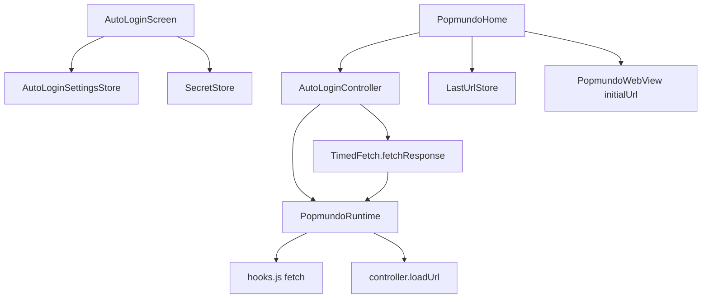

# Auto Login Design

**Spec**: `.specs/features/auto-login/spec.md`
**Status**: Approved (plan confirmed)

---

## Architecture Overview

Pure-Dart orchestration in `popmundo_utils` (settings, last URL, ASP.NET parse, `AutoLoginController`) uses `TimedFetch` + new `PopmundoRuntime.loadUrl`. WebView adapter extends `fetchInPage`/`hooks.js` for redirect-manual + Location header and implements `loadUrl`. App shell owns sidebar UI, `FlutterSecureStorage` as `SecretStore`, wiring, and cold-start `initialUrl`.



---

## Code Reuse Analysis

### Existing Components to Leverage

| Component | Location | How to Use |
| --------- | -------- | ---------- |
| TimedFetch | `packages/popmundo_utils/lib/src/timed_fetch.dart` | Extend with `fetchResponse`; keep `fetch()` for Notifications |
| KeyValueStore | `packages/popmundo_utils/lib/src/storage.dart` | Settings + last URL |
| PopmundoEventBus.navigation | `packages/popmundo_utils/lib/src/events.dart` | Trigger + last URL |
| FakePopmundoRuntime | `packages/popmundo_utils/test/fake_runtime.dart` | Unit tests |
| buildAppMenuItems | `apps/popmundo_app/lib/menu/app_menu_registry.dart` | Add Auto Login item |
| UserScriptsScreen | `apps/popmundo_app/lib/userscripts/` | UI pattern for settings screen |
| Notifications POST | `packages/popmundo_utils/lib/src/notifications.dart` | Shape for TimedFetch POST + useCache:false |

### Integration Points

| System | Integration Method |
| ------ | ------------------ |
| HostTracker | Updated only via `loadUrl` / native navigation (AD-007) |
| CookieManager | Unchanged — document navigation applies Set-Cookie (AD-004) |
| ObservePolicy | Unchanged (AD-003) |

---

## Components

### InPageFetchResult (extended)

- **Purpose**: Carry status/body and redirect Location from in-page fetch
- **Location**: `packages/popmundo_utils/lib/src/popmundo_runtime.dart`
- **Interfaces**:
  - `ok`, `status`, `text` (existing)
  - `Map<String, String> headers` — at least `location` when present (lowercase keys)
  - `String? url` — optional final/request URL
- **Dependencies**: none
- **Reuses**: existing class

### PopmundoRuntime.loadUrl

- **Purpose**: Navigate the WebView document so host sticky + cookies update
- **Location**: contract in utils; impl in `in_app_runtime.dart`; fake in `fake_runtime.dart`
- **Interfaces**: `Future<void> loadUrl(Uri url)`
- **Dependencies**: InAppWebViewController
- **Reuses**: native `loadUrl` API

### TimedFetch.fetchResponse

- **Purpose**: Same serial 750ms queue; return full `InPageFetchResult`; optionally accept 3xx
- **Location**: `packages/popmundo_utils/lib/src/timed_fetch.dart`
- **Interfaces**:
  - `Future<InPageFetchResult> fetchResponse(String resource, {Map options, bool useCache, bool acceptRedirect})`
  - Existing `fetch()` unchanged (still throws on non-2xx, returns text)
- **Dependencies**: PopmundoRuntime
- **Reuses**: queue/cache helpers

### SecretStore

- **Purpose**: Flutter-free secret string API
- **Location**: `packages/popmundo_utils/lib/src/secret_store.dart`
- **Interfaces**: `Future<String?> read(String key)`, `Future<void> write(String key, String value)`, `Future<void> delete(String key)`
- **Dependencies**: none in utils; app implements with FlutterSecureStorage
- **Reuses**: n/a

### AutoLoginSettingsStore

- **Purpose**: Persist non-secret settings
- **Location**: `packages/popmundo_utils/lib/src/autologin/auto_login_settings.dart`
- **Interfaces**: load/save `AutoLoginSettings { enabled, username, characterName, status }`
- **Key**: `autologin.v1`
- **Dependencies**: KeyValueStore
- **Reuses**: UserScriptCatalog persistence pattern

### LastUrlStore

- **Purpose**: Persist eligible last Popmundo URL
- **Location**: `packages/popmundo_utils/lib/src/autologin/last_url_store.dart`
- **Key**: `session.last_url.v1`
- **Interfaces**: `record(String url)`, `Future<String?> read()`, auth-path filter
- **Dependencies**: KeyValueStore, HostTracker.isPopmundoHost

### AspNetForm

- **Purpose**: Parse VIEWSTATE tokens and character submit buttons
- **Location**: `packages/popmundo_utils/lib/src/autologin/aspnet_form.dart`
- **Interfaces**: `extractHidden(html, name)`, `findCharacterButtons(html)`, `matchCharacter(buttons, name)`
- **Dependencies**: none

### AutoLoginController

- **Purpose**: Orchestrate detect → GET → POST login → loadUrl → ChooseCharacter → restore
- **Location**: `packages/popmundo_utils/lib/src/autologin/auto_login_controller.dart`
- **Interfaces**: `start()`, `dispose()`, listens to `runtime.events.navigation`
- **Dependencies**: PopmundoRuntime, TimedFetch, AutoLoginSettingsStore, SecretStore, LastUrlStore
- **Reuses**: Utils patterns; never getServerLink for these paths

### hooks.js fetch

- **Purpose**: Honor `redirect` option; return `headers.location`
- **Location**: `packages/popmundo_webview/assets/js/hooks.js`
- **Reuses**: existing `__popmundo.fetch`

### AutoLoginScreen + SecureStorageSecretStore

- **Purpose**: UI + platform secret backend
- **Location**: `apps/popmundo_app/lib/autologin/`
- **Dependencies**: settings store, SecretStore, menu registry

---

## Data Models

```dart
class AutoLoginSettings {
  final bool enabled;
  final String username;
  final String characterName;
  final int status; // 0,1,2,3,4
}

class CharacterButton {
  final String name;  // ASP.NET name=
  final String value; // "Escolher Troy"
}
```

Secret key: `autologin.password` (SecretStore only).

---

## Error Handling Strategy

| Error Scenario | Handling | User Impact |
| -------------- | -------- | ----------- |
| Missing tokens | Abort cycle | Stay on login |
| 200 after login POST | Abort | Stay on login |
| Missing Location / non-Popmundo | Abort | Stay on login |
| Character not found | Abort | Stay on ChooseCharacter |
| TimedFetchException | Abort, clear inFlight | No loop |
| Secure storage failure on save | SnackBar error | Settings unchanged |

---

## Risks & Concerns

| Concern | Location | Impact | Mitigation |
| ------- | -------- | ------ | ---------- |
| TimedFetch `fetch()` would throw on 302 | `timed_fetch.dart` | Breaks login hop | New `fetchResponse` + `acceptRedirect`; leave `fetch()` alone |
| Fetch does not update HostTracker | AD-007 | Sticky stuck on www | Mandatory `loadUrl` on Location |
| Password in prefs | security | Leak on device dump | SecretStore / flutter_secure_storage |
| Trailing slash via getServerLink | `host_tracker.dart` | Wrong ChooseCharacter path | Absolute paths without resolve() |
| Duplicate NavigationEvents | webview callbacks | Extra last-URL writes | Idempotent same-URL write OK |
| waitUntilReady not reset per nav | `in_app_runtime.dart` | Stale ready after loadUrl | Document; loadUrl then wait on next TimedFetch if needed — or re-ready on loadStop (minimal: rely on existing ready after first page) |

---

## Tech Decisions

| Decision | Choice | Rationale |
| -------- | ------ | --------- |
| Redirect hop | loadUrl after 302 | User choice; cookies + sticky |
| Password | flutter_secure_storage | User choice |
| Contract extension | loadUrl + headers on InPageFetchResult | AD-002 seam |
| Project decision | AD-011 | See STATE.md |
