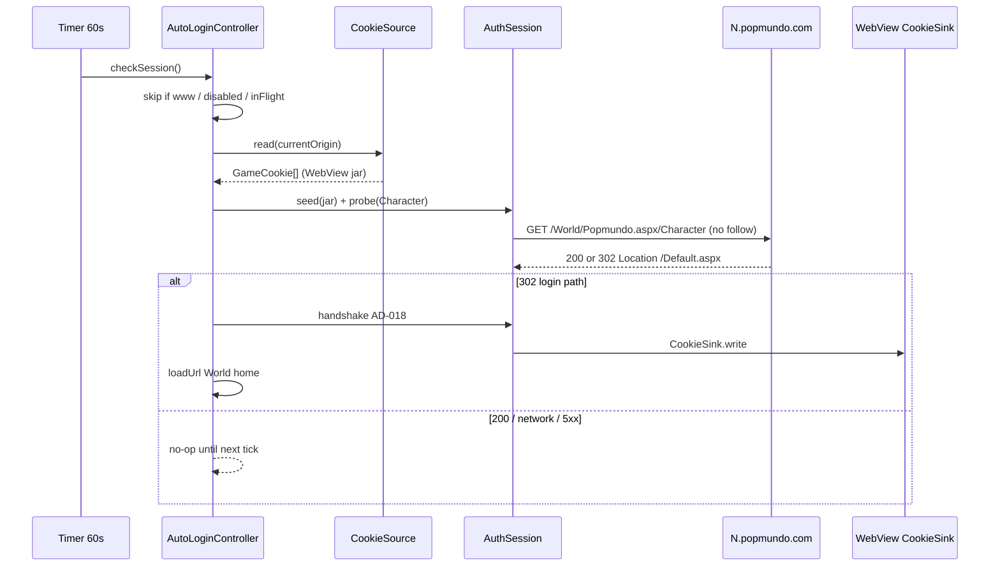

# Auto Login Design — Session Heartbeat

**Spec**: `.specs/features/auto-login/spec.md`
**Context**: `.specs/features/auto-login/context.md`
**Status**: Approved (spec confirmed 2026-08-19)

Handshake silencioso permanece AD-018. Este documento cobre só o **segundo gatilho**: probe de sessão.

O design antigo (TimedFetch + `redirect: 'manual'` + `LastUrlStore`) está **superseded** por AD-017/AD-018; não reexecutar.

---

## Architecture Overview

Probe e handshake compartilham `AuthSession` + jar `GameCookie`. A WebView é a fonte da sessão viva (AD-004); o cliente `dart:io` é semeado a cada tick e, após relogin, despeja de volta via `CookieSink`.

O timer vive no isolate do `AutoLoginController`. O isolate do FGS **não** entra neste fluxo (AD-012).

---

## Code Reuse Analysis

### Existing Components to Leverage

| Component | Location | How to Use |
| --------- | -------- | ---------- |
| `AuthSession` | `auth_http.dart` | New `seed` + `probe` (one GET, no follow). Cooldown 750 ms already there |
| `IoAuthHttpSender` | `auth_http_io.dart` | Unchanged (`followRedirects = false`) |
| `CookieSink` / `MemoryCookieSink` | `cookie_sink.dart` | Add sibling port `CookieSource`; memory double implements both |
| `InAppCookieSink` | `in_app_cookie_sink.dart` | Implement `CookieSource` via `CookieManager.getCookies` |
| `GameCookie.matches` | `game_cookie.dart` | Filter www host-only cookies off the 75 probe |
| `AspNetForm.isLoginPath` | `aspnet_form.dart` | Classify 302 Location |
| `HostTracker.currentOrigin` | `host_tracker.dart` | Sticky `N.` host. **Do not** use `resolve` (trailing slash) |
| `AutoLoginController._runLoginCycle` | `auto_login_controller.dart` | Same cycle when probe says logged out |
| `FakePopmundoRuntime` | `test/fake_runtime.dart` | `waitUntilReady` + host + `authSend` |

### Integration Points

| System | Integration Method |
| ------ | ------------------ |
| AD-003 observe-only | Probe is native HTTP, not intercept |
| AD-006 throttle | `AuthSession` cooldown applies to probe |
| AD-007 sticky host | `currentOrigin.replace(path: characterPath)` |
| AD-012 FGS | Timer on app isolate; FGS isolate unchanged |
| AD-018 handshake | Unchanged; heartbeat is an extra caller of `_runLoginCycle` |

---

## Components

### CookieSource

- **Purpose**: Read the WebView (or test) cookie jar for one URL.
- **Location**: `packages/popmundo_utils/lib/src/autologin/cookie_sink.dart`
- **Interfaces**: `Future<List<GameCookie>> read(Uri url)`
- **Dependencies**: `GameCookie`
- **Reuses**: Same file as `CookieSink`. `MemoryCookieSink` implements both; `seed()` loads cookies without a write.

### AuthSession.probe / seed

- **Purpose**: One GET that does **not** follow redirects; seed jar from WebView cookies.
- **Location**: `auth_http.dart`
- **Interfaces**:
  - `void seed(Iterable<GameCookie> cookies)`
  - `Future<AuthHttpResponse> probe(Uri url)`
  - `static Uri? resolveLocation(Uri from, String location)` (existing helper, public)
- **Dependencies**: `AuthHttpSend`, cooldown
- **Reuses**: `_headersFor`, `_absorb`, `_cooldown`

### AutoLoginController.checkSession

- **Purpose**: 60 s session probe + trigger existing cycle.
- **Location**: `auto_login_controller.dart`
- **Interfaces**:
  - `static const characterPath = '/World/Popmundo.aspx/Character'`
  - `static const heartbeatInterval = Duration(seconds: 60)`
  - `Future<void> checkSession()` — test seam; timer calls this
- **Dependencies**: `cookieSource`, `HostTracker`, `AuthSession`, `_runLoginCycle`
- **Rules**: skip `www.popmundo.com`; skip if source null / read throws; 200 = healthy; 3xx to login path = cycle with `loginPath: '/Default.aspx'` on the **current** origin (still `N.`, not www).

### InAppCookieSink (CookieSource)

- **Purpose**: `CookieManager.getCookies` → `GameCookie`.
- **Location**: `packages/popmundo_webview/lib/src/in_app_cookie_sink.dart`
- **Interfaces**: `gameCookieFromInApp(Cookie cookie, Uri url)` (pure, tested)
- **Mapping**: name/value required; `domain` null or equal to `url.host` → host-only; otherwise `domainAttribute`; path default `/`. Android may omit attributes without `GET_COOKIE_INFO` — name+value still enough to send `Cookie:`.

---

## Data Models

Nenhum modelo novo. `AuthHttpResponse` já tem `status`, `location`, `isRedirect`.

Logout = `response.isRedirect && AspNetForm.isLoginPath(resolveLocation(...).path)`.

---

## Error Handling Strategy

| Error Scenario | Handling | User Impact |
| -------------- | -------- | ----------- |
| CookieManager throws | Skip tick | None |
| `waitUntilReady` throws | Skip tick | None |
| Probe `AuthHttpException` / 4xx / 5xx | Skip tick | None |
| 302 to non-login path | Skip tick | None |
| 302 to `/Default.aspx` | Existing cycle + snackbars | Same as nav trigger |
| iOS process suspend | Timer pauses | Honest; not logout |
| Host still `www` | No GET | Avoids probing before sticky host |

---

## Risks & Concerns

| Concern | Location | Impact | Mitigation |
| ------- | -------- | ------ | ---------- |
| `AutoLoginController` already ~400 lines | `auto_login_controller.dart` | God-file | Heartbeat is `checkSession` + `Timer`; helpers stay on `AuthSession` / `AspNetForm` |
| Existing tests stub `sleep: (_) async {}` | `auto_login_controller_test.dart` | Busy-loop if heartbeat used that sleeper | Heartbeat uses `Timer.periodic`, **not** `_sleep` |
| Android `GET_COOKIE_INFO` | CookieManager | Missing domain/HttpOnly | name+value still sent; host-only assumed when domain absent |
| Probe GET every 60 s | game servers | Throttle / ToS | One hop, no follow, skip www, 750 ms cooldown |
| Stale design.md TimedFetch | this file historically | Drift | This rewrite; handshake = AD-018 |

---

## Tech Decisions

| Decision | Choice | Rationale |
| -------- | ------ | --------- |
| Timer vs FGS ticks | `Timer.periodic(60s)` on controller | FGS ticks every 5 s; must not become a Character GET (HB-07) |
| Test seam | public `checkSession()` | Unit tests must not wait 60 s |
| Login after probe | `_runLoginCycle(loginPath: '/Default.aspx')` against **currentOrigin** | Session died on `N.`; login form exists there (user capture) |
| Cookie port | `CookieSource` sibling of `CookieSink` | Read vs write; AD-002 keeps CookieManager in webview |
| First tick | `waitUntilReady` then `checkSession`, then periodic | Spec HB-01 |

Project-level: **AD-019** (appended to STATE.md).
