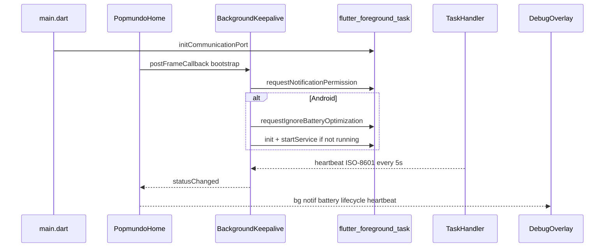

# Background Keepalive Design

**Spec**: `.specs/features/background-keepalive/spec.md`
**Context**: `.specs/features/background-keepalive/context.md`
**Status**: Approved (plan confirmed)

---

## Architecture Overview

Keepalive vive **somente no app shell** (`apps/popmundo_app`). Um facade `BackgroundKeepalive` encapsula `flutter_foreground_task` (permissões, FGS, heartbeat). O isolate do TaskHandler **só** emite timestamps — não chama TimedFetch, não toca WebView, não lê cookies. `PopmundoHome` faz bootstrap pós-frame e injeta o status no `DebugOverlay`. AD-002 / AD-003 / AD-004 / AD-008 permanecem.



---

## Code Reuse Analysis

### Existing Components to Leverage

| Component | Location | How to Use |
| --------- | -------- | ---------- |
| DebugOverlay host line | `apps/popmundo_app/lib/debug_overlay.dart` | Add dense lines under host |
| platform_config_test | `apps/popmundo_app/test/platform_config_test.dart` | Assert new manifest/plist keys |
| debug_overlay_test | `apps/popmundo_app/test/debug_overlay_test.dart` | Pattern for keys + text |
| PopmundoHome bootstrap | `apps/popmundo_app/lib/app.dart` | Wire post-frame keepalive bootstrap |
| Composition root | `apps/popmundo_app/lib/main.dart` | `initCommunicationPort` |

### Integration Points

| System | Integration Method |
| ------ | ------------------ |
| AndroidManifest | Declare FGS perms + plugin service `specialUse` |
| Info.plist | `UIBackgroundModes` fetch + BGTaskScheduler id |
| DebugOverlay | Optional `BackgroundStatus?` prop |
| AppLifecycle | `WidgetsBindingObserver` on home or facade |

---

## Components

### BackgroundStatus (immutable)

- **Purpose**: Snapshot for debug UI
- **Location**: `apps/popmundo_app/lib/background/background_status.dart`
- **Fields**:
  - `notificationGranted` (`bool?` — null = unknown)
  - `batteryUnrestricted` (`bool?` — null on iOS → display `n/a`)
  - `serviceRunning` (`bool`)
  - `lifecycle` (`AppLifecycleState`)
  - `lastHeartbeat` (`DateTime?`)
- **Display helpers**: `bgLabel`, `notifLabel`, `batteryLabel`, `lifecycleLabel`, `heartbeatLabel(now)`

### BackgroundPlatform (port)

- **Purpose**: Abstract plugin calls for fakes in tests
- **Location**: `apps/popmundo_app/lib/background/background_platform.dart`
- **Interfaces**:
  - `Future<bool> isNotificationGranted()`
  - `Future<bool> requestNotificationPermission()`
  - `Future<bool> isIgnoringBatteryOptimizations()` (Android; iOS → true/n-a)
  - `Future<void> requestIgnoreBatteryOptimization()`
  - `Future<bool> isRunningService()`
  - `Future<void> initService()`
  - `Future<void> startService()`
  - `void addTaskDataCallback(void Function(Object) cb)`
  - `void removeTaskDataCallback(void Function(Object) cb)`
  - `bool get isAndroid`
  - `bool get isIOS`

### FlutterForegroundTaskPlatform

- **Purpose**: Real adapter over `FlutterForegroundTask`
- **Location**: `apps/popmundo_app/lib/background/flutter_foreground_task_platform.dart`
- **Reuses**: plugin APIs from README of pinned version

### BackgroundKeepalive

- **Purpose**: Orchestrate bootstrap, observe lifecycle, expose `ValueListenable<BackgroundStatus>` / stream / change notifier
- **Location**: `apps/popmundo_app/lib/background/background_keepalive.dart`
- **Interfaces**:
  - `ValueNotifier<BackgroundStatus> status` (or equivalent listenable)
  - `Future<void> bootstrap()` — notif → battery (Android) → init → start if !running
  - `void onLifecycle(AppLifecycleState)`
  - `void dispose()`
- **Rules**: denied does not throw; start only if `!isRunning`; heartbeat callback updates `lastHeartbeat`

### KeepaliveTaskHandler

- **Purpose**: Isolate entry; emit heartbeat every repeat tick
- **Location**: `apps/popmundo_app/lib/background/keepalive_task_handler.dart`
- **Interfaces**: top-level `@pragma('vm:entry-point') void keepaliveStartCallback()` + `TaskHandler.onRepeatEvent` → `sendDataToMain({'heartbeat': iso8601})`
- **Must not**: TimedFetch, WebView, cookies, KeyValueStore

### DebugOverlay (extended)

- **Purpose**: Show keepalive lines under host
- **Location**: `apps/popmundo_app/lib/debug_overlay.dart`
- **New prop**: `BackgroundStatus? backgroundStatus`
- **Keys**: `debug-bg-service`, `debug-bg-notif`, `debug-bg-battery`, `debug-bg-lifecycle`, `debug-bg-heartbeat`

### Wiring

- `main.dart`: `FlutterForegroundTask.initCommunicationPort()` before `runApp`
- `PopmundoHome`: create keepalive, `addPostFrameCallback` → `bootstrap()`, observe lifecycle, pass status into overlay
- MainActivity: only if plugin README requires `FlutterActivity` subclass change — confirm at implement time

---

## Data Models

```dart
class BackgroundStatus {
  const BackgroundStatus({
    this.notificationGranted,
    this.batteryUnrestricted,
    required this.serviceRunning,
    required this.lifecycle,
    this.lastHeartbeat,
  });

  final bool? notificationGranted;
  final bool? batteryUnrestricted; // null => n/a (iOS)
  final bool serviceRunning;
  final AppLifecycleState lifecycle;
  final DateTime? lastHeartbeat;
}
```

---

## Error Handling Strategy

| Error Scenario | Handling | User Impact |
| -------------- | -------- | ----------- |
| Notification denied | Record denied; continue bootstrap | No crash; debug `notif: denied` |
| Battery deny / dismiss | Record optimized; continue | Debug `battery: optimized` |
| startService throws | Catch; leave `serviceRunning: false` | Debug `bg: stopped` |
| Heartbeat channel fail | Keep previous `lastHeartbeat` | Line may show stale / never |

---

## Risks & Concerns

| Concern | Location | Impact | Mitigation |
| ------- | -------- | ------ | ---------- |
| Android 15+ service duration | FGS specialUse | Continuous session maintenance; no dataSync six-hour cap | Declare subtype; Play distribution requires use-case review |
| iOS does not keep WebView JS alive | Platform | False expectation of live page | Honest debug (lifecycle + frozen heartbeat); cookies AD-004 |
| `REQUEST_IGNORE_BATTERY_OPTIMIZATIONS` Play policy | Manifest | Review before Play publish | OK for sideload MVP |
| Plugin API drift (`initCommunicationPort`) | main.dart | Build break | Confirm against pinned README at implement |
| DebugOverlay stream leak (pre-existing) | debug_overlay.dart | Unrelated debt | Out of scope (same as sidebar spec) |

---

## Tech Decisions

| Decision | Choice | Rationale |
| -------- | ------ | --------- |
| Plugin | `flutter_foreground_task` only | Covers notif + battery + FGS + heartbeat |
| Layer | App shell only | AD-002; utils stays Flutter-free |
| FGS type | `specialUse` | User-requested continuous session maintenance (AD-020) |
| Boot autostart | Off | Policy / out of scope |
| Heartbeat interval | 5000 ms | Balance visibility vs battery |
| Project-level | **AD-012** | Keepalive shell-owned; isolate heartbeat-only |

---

## Project decision to append

### AD-012
Keepalive de sessão em segundo plano vive no app shell via `flutter_foreground_task`. O isolate do Foreground Service só emite heartbeat; não executa TimedFetch nem toca o WebView. Cookies/sessão continuam AD-004; intercept observe-only AD-003.
