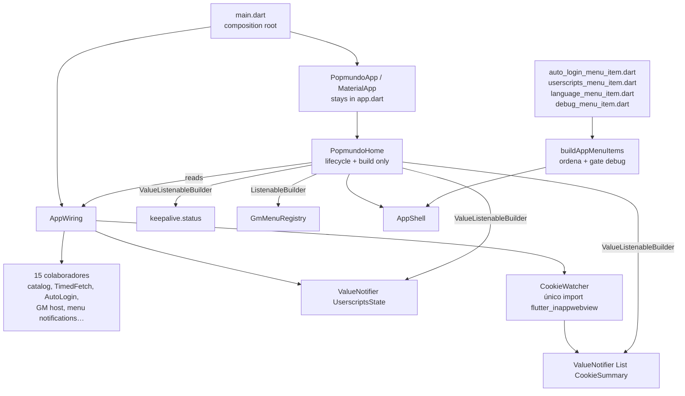

# Design: Composition Root Scaling

Requirements source: [spec.md](spec.md) (CRS-01…CRS-18). Approved plan:
`/home/wellbritto/.claude/plans/beleza-vamos-la-comece-ancient-beacon.md`.

## Guiding constraint

Every decision below is measured against one question: **does it reduce the number of files and
lines an agent must load to add a feature?** Anything that adds a file without removing edit points
is rejected. No new dependency, no new indirection, no port that has only one implementation.

---

## 1. Package slicing — `popmundo_utils/lib/src` (CRS-15, CRS-16)

`lib/src` becomes five directories with zero loose files:

| Directory | Files | Why together |
| --- | --- | --- |
| `core/` | `popmundo_runtime.dart`, `events.dart`, `host_tracker.dart`, `timed_fetch.dart`, `storage.dart`, `secret_store.dart`, `logger.dart`, `observe_policy.dart` | Infrastructure with no page/DOM dependency. The runtime port, its event bus, the sticky host, the throttled fetch, and the two storage contracts |
| `facades/` | `notifications.dart`, `css_selector.dart`, `scoring.dart`, `utils.dart` | Page-facing readers. Three call `window.__popmundo.*` via `runtime.evaluate`; `utils.dart` reads the same surface through a cached `TimedFetch` GET + `package:html` because those DOM nodes are absent on most routes |
| `autologin/`, `userscript/`, `menu_notifications/` | unchanged | Already slices |

**Name choice — `facades/`, not `page/`.** `docs/ARQUITETURA.md`'s pattern table labels this row
**Facade** and `packages/popmundo_utils/README.md` already has a "Facades" row covering exactly
these four files. Reusing the established word costs nothing; introducing `page/` would give the
same concept a second name across the docs.

**Import rewrites.** `core/` → `core/` imports stay bare (all eight move together). Everything else
is a mechanical `'../X.dart'` → `'../core/X.dart'`, plus `facades/*`'s bare sibling imports becoming
`'../core/...'`. The 11 `../` import lines across the three existing slices are enumerated in
[tasks.md](tasks.md). Two carry selective shows that must survive verbatim:
`auth_http.dart`'s `show ClockNow, Sleeper` and `auto_login_controller.dart`'s `show ClockNow`.

**Public surface.** The barrel `lib/popmundo_utils.dart` rewrites 12 export *paths*. The exported
*symbol set* is unchanged, so `popmundo_webview` and `popmundo_app` need zero edits — verified: no
file outside the package deep-imports `package:popmundo_utils/src/...`, the package's own tests
import only the barrel, `example/popmundo_utils_example.dart` imports only the barrel, and there are
no `part`/`part of` directives anywhere in the package. `flutter analyze` on all three packages is
the proof gate for CRS-16.

---

## 2. Dead code removal (CRS-17)

`PopmundoScope` (an `InheritedWidget`) is constructed at `app.dart:331`; `PopmundoScope.of` has
zero call sites repo-wide. Deleting it also strands `late final storage = StorageService(widget.store)`
(`app.dart:96`) — that instance exists **only** to populate the scope's `storage` field
(`app.dart:388`). Both go. `StorageService` itself remains in `popmundo_utils` (it has its own tests
in `test/storage_test.dart`); only the app-side instance is removed.

This supersedes a prior recorded decision: `docs/ARQUITETURA.md:255` lists `PopmundoScope` in the
known-dead-code table with the rationale *"Decisão de manter o menu agnóstico do runtime"*, and
`.specs/features/app-sidebar-menu/design.md` records it as kept-by-design. AD-022 states the
supersession explicitly. The historical `design.md`/`tasks.md`/`validation.md` of that feature are
execution records and are **not** edited; that feature's `spec.md` never mentions `PopmundoScope`,
so no `SPEC_DEVIATION` marker is needed.

---

## 3. Menu registry becomes feature-owned (CRS-02, CRS-05, CRS-06, CRS-07)

```dart
// lib/menu/app_menu_registry.dart
List<AppMenuItem> buildAppMenuItems({
  required List<AppMenuItem> items,
  AppMenuItem? debugItem,
  bool includeDebugItem = kDebugMode,
}) => [
      ...items,
      if (includeDebugItem && debugItem != null) debugItem,
    ];
```

The three invariants the current tests lock are now expressed **structurally** rather than
hardcoded in the body: order comes from the caller's list (CRS-05), debug is appended last and only
when gated (CRS-05, CRS-06), and the `kDebugMode` default is unchanged (CRS-06). No new type is
introduced — a plain `List<AppMenuItem>` plus a nullable `debugItem` is the minimum that satisfies
the requirement.

Each feature owns its item, in its own folder:

| File | Function |
| --- | --- |
| `lib/autologin/auto_login_menu_item.dart` | `AppMenuItem autoLoginMenuItem({required VoidCallback onTap})` |
| `lib/userscripts/userscripts_menu_item.dart` | `userscriptsMenuItem({required VoidCallback onTap})` |
| `lib/language/language_menu_item.dart` | `languageMenuItem({required VoidCallback onTap})` |
| `lib/menu/debug_menu_item.dart` | `debugMenuItem({required VoidCallback onTap})` |

Labels/subtitles stay live `.tr()` lookups (CRS-07 — the PT test depends on this). The debug item
lives in `lib/menu/`, not a new `lib/debug/`: debug is a shell capability, not a feature slice, and
it sits next to the registry that gates it.

Call site in `app.dart`:

```dart
items: buildAppMenuItems(
  items: [
    autoLoginMenuItem(onTap: _openAutoLogin),
    userscriptsMenuItem(onTap: _openUserScripts),
    languageMenuItem(onTap: _openLanguage),
  ],
  debugItem: debugMenuItem(onTap: () => setState(() => _debugPanelVisible = true)),
),
```

**Adding a feature = one line here + one file in its own folder.** That is CRS-02.

### Test redistribution

`app_menu_registry_test.dart` today asserts feature identities (`'auto-login'`, `'userscripts'`)
inside what is really a generic ordering utility. After the change it tests only ordering/gating,
using stub `AppMenuItem`s, and each feature's label/`onTap`/PT assertions move next to that feature:

| Current test | Destination |
| --- | --- |
| order + ids (×2), `kDebugMode` default | stay in `app_menu_registry_test.dart`, rewritten against stubs |
| auto-login label/subtitle + `onTap` + PT label | new `test/auto_login_menu_item_test.dart` |
| userscripts label + `onTap` | new `test/userscripts_menu_item_test.dart` |
| language label + `onTap` + PT label | new `test/language_menu_item_test.dart` |
| debug label/subtitle + `onTap` | new `test/debug_menu_item_test.dart` |

Flat test files (not a `test/menu/` subfolder) — that matches the dominant convention in this repo
(`auto_login_screen_test.dart`, `language_selector_test.dart`, …).

---

## 4. `AppWiring` (CRS-01, CRS-03, CRS-04, CRS-09…CRS-12, CRS-14)

### Placement

`AppWiring` is constructed in **`main.dart`**, which already builds `InAppPopmundoRuntime`,
`SharedPreferencesStore`, `BackgroundKeepalive` and `LocalNotificationsService`. It becomes the
single true composition root. `PopmundoApp` and `PopmundoHome` collapse from five constructor
parameters each to **one** (`wiring`). The `secretStore ?? FlutterSecureSecretStore()` default moves
from `PopmundoApp.build` into `AppWiring`'s constructor.

`PopmundoApp` and its `MaterialApp` **stay textually in `lib/app.dart`** with the four scanned
substrings byte-identical — `localization_boot_test.dart:44-70` greps the file's source text, so
this is a hard placement constraint (CRS-13).

### Shape

```dart
class UserscriptsState {
  const UserscriptsState({required this.ready, required this.all,
                          required this.enabled, required this.previouslyEnabledIds});
  factory UserscriptsState.loading() => ...;
  final bool ready;
  final List<InstalledUserScript> all;
  final List<InstalledUserScript> enabled;
  final Set<String> previouslyEnabledIds;
}

class AppWiring {
  AppWiring({required this.runtime, required KeyValueStore store,
             SecretStore? secretStore, this.keepalive, this.notificationService})
      : secretStore = secretStore ?? FlutterSecureSecretStore() { /* build collaborators */ }

  final userscripts = ValueNotifier<UserscriptsState>(UserscriptsState.loading());
  late final cookieWatcher = CookieWatcher(runtime.host);
  final gmMenuRegistry = GmMenuRegistry();          // already a ChangeNotifier
  // … the remaining collaborators …

  void start();                                     // CRS-10: guarded, idempotent
  Future<void> dispose();                           // CRS-11
  Future<void> applyUserScripts(List<InstalledUserScript> next);   // CRS-12
  List<String> connectHeadersFor(String scriptId);
}
```

`AppWiring` references no `BuildContext`, `State`, `Navigator`, or widget type (CRS-04). Its only
Flutter import is `foundation`/`widgets` for `ValueNotifier` and the single
`WidgetsBinding.instance.addPostFrameCallback` used to time `keepalive.bootstrap()` — frame timing,
not UI.

**CRS-10 (idempotent `start`)** is implemented with an explicit `bool _started` guard returning
early. Today's code has no such guard because `initState` runs once by construction; extracting into
a plain object removes that guarantee, so the guard is a real new requirement, not ceremony.

**CRS-12** is the diff contract: `_publishUserscripts` recomputes
`previouslyEnabledIds = {for (final s in enabled) s.id}` on every publish, and `applyUserScripts`
reads `userscripts.value.previouslyEnabledIds` *before* publishing — preserving today's ordering
where `syncUserScripts` receives the **previous** enabled set.

**CRS-09** preserves both existing swallow points verbatim: `PopmundoRuntimeException` around
`syncUserScripts` (WebView not attached yet) and the bare `catch` around `CookieManager`
(unavailable in some test/desktop bindings).

### `CookieWatcher`

`lib/cookie_watcher.dart` — a ~20-line concrete class holding
`ValueNotifier<List<CookieSummary>> cookies` and a `refresh()`. It is **not** a port (one
implementation, no interface). Its job is to be the single named home for the app layer's one
documented `flutter_inappwebview` import, which today sits anonymously inside `_refreshCookies` in
`app.dart`. `CookieSummary` stays defined in `debug_overlay.dart` and is imported
`show CookieSummary` — a pure value type, no widget dependency.

CLAUDE.md's note ("`apps/popmundo_app/lib/app.dart` imports `flutter_inappwebview` directly") must
be repointed at this file.

### Disposition of the seven `setState` fields

| Field | Disposition | How `build` consumes |
| --- | --- | --- |
| `_backgroundStatus` + `_onKeepaliveStatus` | **deleted** — `keepalive.status` is already a `ValueListenable` | `ValueListenableBuilder` directly on it, with a null-`keepalive` branch |
| `_onGmMenuChanged` (an empty `setState`) | **deleted** — `GmMenuRegistry` is already a `ChangeNotifier` | `ListenableBuilder` on `wiring.gmMenuRegistry` |
| `_cookies` | → `wiring.cookieWatcher.cookies` | `ValueListenableBuilder` |
| `_bootstrapReady`, `_enabledUserScripts`, `_allUserScripts`, `_previouslyEnabledIds` | → one `wiring.userscripts` notifier | `ValueListenableBuilder` |
| `_debugPanelVisible` | **stays** a `State` field | plain `setState` — a pure UI toggle with no collaborator behind it; converting it would be ceremony |

### What stays in `_PopmundoHomeState`

Only what is genuinely widget-bound: the `WidgetsBindingObserver` registration and
`didChangeAppLifecycleState`; the `autoLogin.status` subscription (its handler needs
`Theme.of(context)` for the error-colored SnackBar, plus the static `scaffoldMessengerKey`);
`_openUserScripts`/`_openAutoLogin` (`Navigator.of(context).push`); `_openLanguage`
(`showLanguageDialog(context)`); `_debugPanelVisible`; and `build`.

`initState`/`dispose` drop from ~40 lines to ~12.

---

## 5. Component diagram



---

## 6. Sequencing rationale

Order is **A1 → A2 → A3 → C → B**. A1 lands first so B's diff is measured against already-clean
code (no `PopmundoScope`, no dead `storage`). C lands before B because it is isolated to `menu/` +
one expression in `build`, and folding it into B's large diff would make both harder to review. B
splits into two commits — *add unwired files*, then *rewire* — which is the right granularity given
that **zero** tests construct `PopmundoHome`, so finer commits buy no safety.

## 7. Explicitly rejected

| Considered | Rejected because |
| --- | --- |
| `AppMenuContribution` wrapper type | A `List<AppMenuItem>` + nullable `debugItem` does the same job with no new type |
| `typedef AppMenuItemBuilder` / a `MenuSlot` ordering enum | Indirection with no removed edit point |
| Deleting `buildAppMenuItems` and inlining the 4-line list into `build` | It is the documented, tested extension point `lib/menu/README.md` points at; removing a seam to save one small file is a bad trade |
| `lib/debug/` folder for `debug_overlay.dart` | Debug is a shell capability; `lib/` root already holds the shell's flat files. Costs 3 test-import updates for zero gain |
| Converting `_debugPanelVisible` to a notifier | Pure UI toggle, no collaborator |
| A port/interface for `CookieManager` | One implementation. CLAUDE.md documents the coupling as intentional — this relocates it, does not abstract it |
| Four separate ADs (one per item) | They share one rationale. Four ADs would be exactly the ceremony this feature removes |
