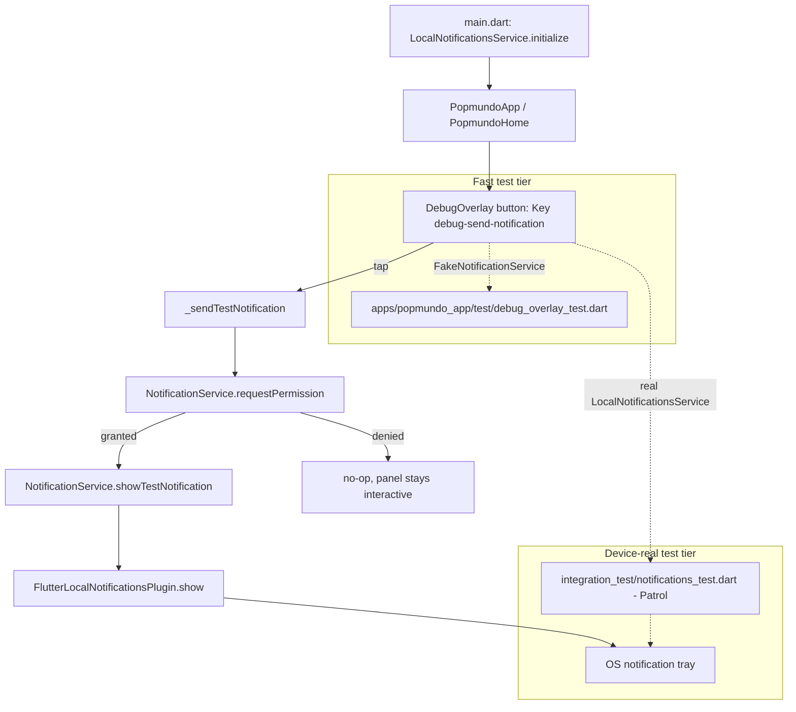

# Local Notifications MVP Design

**Spec**: `.specs/features/local-notifications/spec.md`
**Status**: Approved

---

## Architecture Overview

Interface + fake split, mirroring the existing `apps/popmundo_app/lib/background/` pattern (`BackgroundPlatform`/`FlutterForegroundTaskPlatform`/fakes). A `NotificationService` abstract contract is the seam: the real implementation (`LocalNotificationsService`) is the only code that touches `flutter_local_notifications`; a `FakeNotificationService` stands in for the fast, device-free widget-test tier. Wiring follows the exact shape the codebase already uses for `keepalive`: constructed in `main.dart`, threaded down through `PopmundoApp` → `PopmundoHome` → `DebugOverlay` as a constructor param.

**Rejected alternatives** (approach exploration, confirmed with user before detailing components):

- **No abstraction, inline in `DebugOverlay`** — fewest files, but `flutter_local_notifications`' platform channel isn't fakeable, so the existing fast-tier `debug_overlay_test.dart` convention (fake collaborators, no real plugin) couldn't exercise the button without a device. Rejected: breaks the fast/device-real test-tier split (AD-015).
- **Stateful orchestrator mirroring `BackgroundKeepalive` fully** (`ValueNotifier<Status>`, `bootstrap()`/`dispose()`) — maximum symmetry with the keepalive precedent, but this feature has no ongoing lifecycle to track (NOTIF-01..08 describe a single fire-and-forget action). Rejected as over-engineered for the scope.

---

## Code Reuse Analysis

### Existing Components to Leverage

| Component | Location | How to Use |
| --- | --- | --- |
| `BackgroundPlatform` / `FlutterForegroundTaskPlatform` / fakes | `apps/popmundo_app/lib/background/background_platform.dart`, `flutter_foreground_task_platform.dart` | Structural pattern to mirror exactly: abstract contract + real impl + fake, injected via constructor. |
| `DebugOverlay` button convention | `apps/popmundo_app/lib/debug_overlay.dart:113-124` (`debug-clear`/`debug-close` `TextButton`/`IconButton` rows) | Add one more row with `Key('debug-send-notification')`, same `_panel()` `ListView` structure. |
| `main.dart` composition-root pattern | `apps/popmundo_app/lib/main.dart:13-36` | Instantiate + initialize the service before `runApp`, pass into `PopmundoApp` exactly like `keepalive`. |
| `PopmundoApp`/`PopmundoHome` optional-service threading | `apps/popmundo_app/lib/app.dart:26-37, 61-73` (`keepalive` param) | Add `notificationService` as a sibling optional constructor param, same nullable-and-forwarded shape. |
| Patrol harness helpers | `apps/popmundo_app/integration_test/support/harness.dart` (`pumpHarness`, `grantNotificationsIfAsked($)`) | Reused as-is for the permission-grant step; no new OS-dialog-handling code needed. |
| Fast-tier widget-test pattern | `apps/popmundo_app/test/debug_overlay_test.dart` (`find.byKey` → `tester.tap` → `pump`) | Same pattern, new assertions against `FakeNotificationService` call counts. |

### Integration Points

| System | Integration Method |
| --- | --- |
| `flutter_local_notifications` plugin | Wrapped entirely inside `LocalNotificationsService`; nothing else in the app imports the package directly. |
| Android `POST_NOTIFICATIONS` manifest permission | Already declared (AD-012/FGS-04) — verified only, no manifest edit. |
| `easy_localization` | Deliberately NOT used for notification text — see Tech Decisions (AD-014 carve-out). |

---

## Components

### `NotificationService` (interface)

- **Purpose**: Seam between the debug UI and the notification plugin, so the plugin never has to run under `flutter test`.
- **Location**: `apps/popmundo_app/lib/notifications/notification_service.dart`
- **Interfaces**:
  - `Future<void> initialize()` — one-time plugin/channel setup (NOTIF-01). Must swallow its own errors (NOTIF-08).
  - `Future<bool> requestPermission()` — requests (or reads, if already decided) the OS notification permission; returns the grant state (NOTIF-03).
  - `Future<void> showTestNotification()` — shows the fixed notification using a fixed id/channel (NOTIF-04, NOTIF-07).
- **Dependencies**: none (pure contract).
- **Reuses**: shape of `BackgroundPlatform`.

### `LocalNotificationsService` (real implementation)

- **Purpose**: Only class that imports `flutter_local_notifications`.
- **Location**: `apps/popmundo_app/lib/notifications/local_notifications_service.dart`
- **Interfaces**: implements `NotificationService`.
  - `initialize()`: builds `AndroidInitializationSettings('@mipmap/ic_launcher')` + `DarwinInitializationSettings(requestSoundPermission: false, requestBadgePermission: false, requestAlertPermission: false)` (permission deferred to `requestPermission()`), calls `plugin.initialize(settings: ...)` inside a try/catch that leaves an internal `_initialized = false` on failure (NOTIF-08).
  - `requestPermission()`: `Platform.isAndroid` → `plugin.resolvePlatformSpecificImplementation<AndroidFlutterLocalNotificationsPlugin>()?.requestNotificationsPermission()` (no-op / returns current grant below API 33 — Context7-verified); `Platform.isIOS` → `...resolvePlatformSpecificImplementation<IOSFlutterLocalNotificationsPlugin>()?.requestPermissions(alert: true, badge: true, sound: true)`; other platforms → `true` (N/A, AD-008 scopes this app to Android/iOS only, but the plugin no-ops safely elsewhere).
  - `showTestNotification()`: no-ops if `!_initialized` (NOTIF-08); otherwise calls `plugin.show(kTestNotificationId, kTestNotificationTitle, kTestNotificationBody, NotificationDetails(android: AndroidNotificationDetails('popflutter_debug_channel', 'Debug', channelDescription: ..., importance: Importance.max, priority: Priority.high)))` — fixed id so repeat taps replace rather than stack (NOTIF-07).
- **Dependencies**: `flutter_local_notifications` (new pubspec dependency), `dart:io` (`Platform`).
- **Reuses**: shape of `FlutterForegroundTaskPlatform`.

### `FakeNotificationService` (test double)

- **Purpose**: Records calls for the fast widget-test tier; lets tests simulate denial, init failure, and in-flight delay.
- **Location**: `apps/popmundo_app/lib/notifications/fake_notification_service.dart`
- **Interfaces**: implements `NotificationService`; exposes `initializeCalls`, `requestPermissionCalls`, `showCalls` counters plus configurable `permissionGranted`, `initializeError`, `showDelay` fields.
- **Dependencies**: none.
- **Reuses**: n/a (new test double, same spirit as existing fakes under `apps/popmundo_app/test/`).

### `DebugOverlay` changes

- **Purpose**: Add the manual trigger UI.
- **Location**: `apps/popmundo_app/lib/debug_overlay.dart` (existing file, owned by `popmundo-app-shell`).
- **Interfaces**: new optional constructor param `NotificationService? notificationService`; new private state `_sendingNotification` (bool) and method `Future<void> _sendTestNotification()`.
  - `_sendTestNotification()`: guards on `service == null || _sendingNotification` (NOTIF-06, via disabled button — `onPressed: _sendingNotification ? null : _sendTestNotification`, which also makes repeat taps physically no-ops during the in-flight window rather than needing a separate debounce flag check); calls `requestPermission()` then, if granted, `showTestNotification()`; wraps both in try/catch so any thrown error never crashes the panel (NOTIF-05, NOTIF-08); resets `_sendingNotification` in `finally`.
  - New row in `_panel()`: `TextButton(key: const Key('debug-send-notification'), onPressed: ..., child: const Text('send test notification'))` — fixed English label, consistent with every other string already in this widget (AD-014 carve-out).
- **Dependencies**: `NotificationService`.
- **Reuses**: existing `_panel()` `ListView`/`TextButton` row pattern.

### `main.dart` / `app.dart` wiring

- **Purpose**: Composition root + threading, no new abstractions.
- **Location**: `apps/popmundo_app/lib/main.dart`, `apps/popmundo_app/lib/app.dart`.
- **Interfaces**: `main.dart` — `final notificationService = LocalNotificationsService(); await notificationService.initialize();` before `runApp`, passed into `PopmundoApp(notificationService: notificationService)`. `PopmundoApp`/`PopmundoHome` gain `final NotificationService? notificationService;`, forwarded to `DebugOverlay`.
- **Dependencies**: `LocalNotificationsService`.
- **Reuses**: identical shape to the existing `keepalive` param at `app.dart:31-37, 67-73`.

### `integration_test/notifications_test.dart` + `harness.dart` addition

- **Purpose**: Device-real proof that a real notification with the expected text appears in the system tray (`popmundo-e2e` domain).
- **Location**: `apps/popmundo_app/integration_test/notifications_test.dart` (new), `apps/popmundo_app/integration_test/support/harness.dart` (extended).
- **Interfaces**: exactly one `patrolTest`; sequences NOTIF-03/04/05 as one flow with a `reason:` on each `expect`, using `pumpHarness()` with a real `LocalNotificationsService`, tapping `Key('debug-send-notification')`, `grantNotificationsIfAsked($)`, then `$.platform.mobile.openNotifications()`/`getNotifications()` (same API `keepalive_test.dart` already uses) to assert the fixed title/body text is present.
- **Dependencies**: `LocalNotificationsService`, `harness.dart`.
- **Reuses**: `keepalive_test.dart`'s structure and `grantNotificationsIfAsked($)` verbatim.

---

## Data Models

None. No persisted state is introduced — the notification's id, channel id, title, and body are compile-time constants (see Tech Decisions). `FakeNotificationService`'s call counters exist only for the duration of a single test.

---

## Error Handling Strategy

| Error Scenario | Handling | User Impact |
| --- | --- | --- |
| `initialize()` throws (bad channel config, plugin init failure) | Caught inside `LocalNotificationsService.initialize()`; `_initialized` stays `false` | Button becomes a silent no-op on every later tap (NOTIF-08) — no crash, no error UI in this MVP |
| `requestPermission()` returns `false` (denied) | `_sendTestNotification` skips `showTestNotification()` | No notification appears; debug panel stays interactive (NOTIF-05) |
| `showTestNotification()` throws | Caught by `_sendTestNotification`'s try/catch in `DebugOverlay` | Same as above — panel stays usable, no crash |
| Repeat tap while a previous tap is still in flight | Button `onPressed` is `null` while `_sendingNotification == true` | Tap is physically inert; no duplicate concurrent permission dialogs (NOTIF-06) |

---

## Risks & Concerns

| Concern | Location | Impact | Mitigation |
| --- | --- | --- | --- |
| Android notification channel collision with the existing keepalive FGS notification | `apps/popmundo_app/lib/background/flutter_foreground_task_platform.dart:48` uses channel id `popmundo_keepalive` | A shared channel id would mix a persistent keepalive notification with a one-shot debug notification under the same settings/importance | Use a distinct channel id (`popflutter_debug_channel`) — deliberate choice, not shared |
| Android launcher icon reference (`@mipmap/ic_launcher`) unverified for `AndroidInitializationSettings` | `android/app/src/main/res/mipmap-*/` (not yet inspected file-by-file) | If the resource name doesn't resolve, `initialize()` fails at runtime, which is survivable (NOTIF-08) but the button would silently never work | Verify the resource exists as an implementation task before wiring; the launcher icon is a near-certain default (every Flutter app scaffold has it) |
| `PopmundoHome`'s constructor is already a long list of `late final` services (main.dart/app.dart) | `apps/popmundo_app/lib/app.dart:89-121` | Pre-existing readability concern, not introduced by this feature | Out of scope — this feature adds one more param in the same existing shape; not a refactor task |
| Fast tier can't verify real system-tray content | inherent to `flutter test` | A logic bug in `LocalNotificationsService` itself (not `DebugOverlay`) wouldn't be caught by the fast tier | Covered by the device-real Patrol test tier per AD-015 — this is the tier's whole purpose |

---

## Tech Decisions (only non-obvious ones)

| Decision | Choice | Rationale |
| --- | --- | --- |
| Notification text is fixed English, not localized | No `easy_localization` catalog entries | AD-014 (active) already carves out that `DebugOverlay` stays English because it's debug-only/never in release; this notification is only reachable via that same gate (NOTIF-02) |
| No `permission_handler` dependency | Use `flutter_local_notifications`' own `requestNotificationsPermission()`/`requestPermissions()` | Context7-verified current API; avoids a redundant package for a single permission |
| Fixed notification id (reused every `show()` call) | Replaces rather than stacks per NOTIF-07 | Matches the plugin's documented replace-on-same-id behavior |
| Interface + fake split instead of inline plugin usage | `NotificationService`/`LocalNotificationsService`/`FakeNotificationService` | Keeps `apps/popmundo_app/test/` device-free, mirrors `background/`'s existing convention (user-confirmed architecture choice) |

No new `STATE.md` AD entry — this reuses an existing pattern (`background/`'s platform-interface split) rather than establishing a new one.

---
