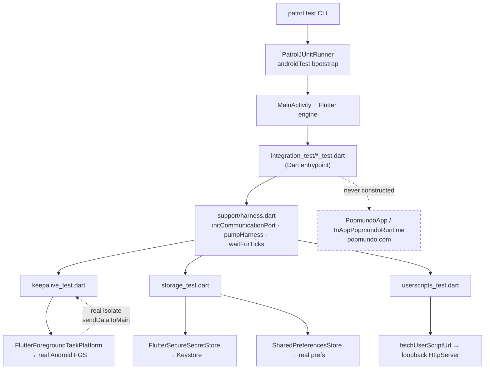

# Mobile E2E Tests (Device-Real Tier) Design

**Spec**: `.specs/features/mobile-e2e-tests/spec.md`
**Status**: Draft

---

## Architecture Overview

A second test tier lives beside the existing fast tier. It never replaces it — the two answer different questions.

| Tier | Location | Runner | Substitutes | Answers |
| ---- | -------- | ------ | ----------- | ------- |
| Fast (existing) | `apps/popmundo_app/test/` | `flutter test` | `FakeBackgroundPlatform`, `MemoryKeyValueStore` | "Is the orchestration logic right?" |
| Device-real (new) | `apps/popmundo_app/integration_test/` | `patrol test` | nothing — real Android APIs | "Does it actually work on a phone?" |

The load-bearing fact that makes this safe: **with `integration_test`/Patrol, the Dart entrypoint is the test file, not `lib/main.dart`.** `PopmundoApp` is never constructed, `InAppPopmundoRuntime` is never created, and no WebView is ever pointed at popmundo.com. The hard constraint from `CLAUDE.md` is satisfied structurally, not by discipline.

The consequence — and the first landmine — is that `lib/main.dart`'s setup does not run either. `FlutterForegroundTask.initCommunicationPort()` lives there (`main.dart:13`), and the plugin docs state it "must be called before using task data callbacks." Without it the heartbeat (KA-03) would never arrive and the test would fail for an unrelated reason. The support layer owns this.

---

## Approach Exploration

All three deliver the same scoped thing; they differ in how tests reach the objects under test.

### Approach A — Pure Patrol, one file per area + shared support layer ⭐ Recommended

`integration_test/{keepalive,storage,userscripts}_test.dart` plus `integration_test/support/`. Each test builds only the object under test and, where a widget is needed, pumps a minimal `MaterialApp` harness.

- **Pro**: zero production code changes; one runner, one command; each area's file is independently runnable via `--target`
- **Pro**: the "never boot the real app" constraint is enforced by construction — there is no code path to `PopmundoApp`
- **Con**: harness widgets are test-authored, so they can drift from how `app.dart` really wires things

### Approach B — Test-only entrypoint in `lib/`

Add `lib/main_e2e.dart` that boots the shell with the WebView swapped out.

- **Pro**: tests exercise the real composition root
- **Con**: `PopmundoApp` requires a `PopmundoRuntime`; avoiding the WebView means inventing a null-object runtime **in production code, solely for tests** — a new prod abstraction to serve the test tier
- **Con**: grows the shipped surface with a file that must never run in production
- **Rejected**: the cost lands in `lib/`, which is exactly where it should not.

### Approach C — Patrol for keepalive, plain `integration_test` for storage/userscripts

Only keepalive needs native automation; the other two would run under plain `integration_test`.

- **Pro**: cheaper runner for two of three areas
- **Con**: two runners, two commands, two configs, two mental models — for a saving that is near zero, since Patrol executes ordinary `integration_test`-style bodies unchanged
- **Rejected**: splits the tier for no real gain.

**Recommendation: A.**

---

## Code Reuse Analysis

### Existing Components to Leverage

| Component | Location | How to Use |
| --------- | -------- | ---------- |
| `BackgroundKeepalive` | `lib/background/background_keepalive.dart` | Instantiate directly with the **real** platform — the class is already constructor-injected, so no change is needed |
| `FlutterForegroundTaskPlatform` | `lib/background/flutter_foreground_task_platform.dart` | The system under test for KA-01/02/04. First coverage it has ever had |
| `KeepaliveTaskHandler` | `lib/background/keepalive_task_handler.dart` | Runs for real in the FGS isolate; the test asserts its output arrives (KA-03) |
| `BackgroundStatus` | `lib/background/background_status.dart` | `status.value.serviceRunning` / `lastHeartbeat` are the assertion surface |
| `FlutterSecureSecretStore` | `lib/autologin/secure_secret_store.dart` | SUT for STO-01/02 |
| `SharedPreferencesStore` | `lib/prefs_store.dart` | SUT for STO-04/05 |
| `fetchUserScriptUrl` | `lib/userscripts/userscript_http.dart` | SUT for US-01/03/04 |
| `AutoLoginSettingsStore`, `UserScriptCatalog`, `UserScriptImporter` | `packages/popmundo_utils` | Reused as-is over real stores |
| `FakeBackgroundPlatform` | `test/fake_background_platform.dart` | **Deliberately not reused** — the whole point is the real platform |

### Integration Points

| System | Integration Method |
| ------ | ------------------ |
| Android instrumentation | `PatrolJUnitRunner` via `testInstrumentationRunner` in `build.gradle.kts` (Kotlin DSL syntax) |
| Existing fast tier | Untouched. `flutter test` only globs `test/`, so `integration_test/` is ignored automatically (E2E-05) |
| `flutter_foreground_task` | Real plugin calls; `initCommunicationPort()` moved into the test support layer |

---

## Components

### `integration_test/support/harness.dart`

- **Purpose**: The one place that knows what `lib/main.dart` does at boot, so no individual test has to remember it.
- **Location**: `apps/popmundo_app/integration_test/support/harness.dart`
- **Interfaces**:
  - `void initForegroundComms()` — calls `FlutterForegroundTask.initCommunicationPort()`; idempotent, called at the top of any keepalive test
  - `Future<void> pumpHarness(PatrolIntegrationTester $, Widget child)` — wraps `child` in a minimal `MaterialApp` and settles
  - `Future<List<DateTime>> waitForTicks(ValueNotifier<BackgroundStatus> status, {int count = 2, Duration timeout = const Duration(seconds: 30)})` — collects `count` **distinct** heartbeats or throws a descriptive `TimeoutException`
  - `Future<void> grantNotificationsIfAsked(PatrolIntegrationTester $)` — guards with `isPermissionDialogVisible()` before granting, so an already-granted device does not hang
- **Dependencies**: `patrol`, `flutter_foreground_task`, `popmundo_app`
- **Reuses**: `BackgroundStatus.lastHeartbeat` as the tick source

### `integration_test/keepalive_test.dart`

- **Purpose**: KA-01…KA-06 against the real foreground service.
- **Location**: `apps/popmundo_app/integration_test/keepalive_test.dart`
- **Dependencies**: harness, `BackgroundKeepalive`, `FlutterForegroundTaskPlatform`
- **Notes**: One `patrolTest` per criterion where cheap; KA-05/KA-06 share a single test because backgrounding is a sequence, not two independent facts.

### `integration_test/storage_test.dart`

- **Purpose**: STO-01…STO-05 against the real Keystore and real SharedPreferences.
- **Location**: `apps/popmundo_app/integration_test/storage_test.dart`
- **Notes**: STO-03 reads every key via `SharedPreferences.getKeys()` and asserts no stored value equals the written password — the executable form of "the password lives only in `SecretStore`".

### `integration_test/userscripts_test.dart`

- **Purpose**: US-01…US-04 over real sockets.
- **Location**: `apps/popmundo_app/integration_test/userscripts_test.dart`
- **Notes**: `HttpServer.bind(InternetAddress.loopbackIPv4, 0)` per test, torn down in `addTearDown`. Port `0` means the OS assigns — nothing hardcoded, nothing to collide.

### Android test bootstrap

- **Purpose**: Lets the instrumentation enumerate and run Dart tests.
- **Location**: `apps/popmundo_app/android/app/src/androidTest/java/com/popmundo/popmundo_app/MainActivityTest.java`
- **Notes**: Parameterized JUnit class per Patrol docs, referencing `MainActivity` and package `com.popmundo.popmundo_app`.

---

## Error Handling Strategy

| Error Scenario | Handling | Impact |
| -------------- | -------- | ------ |
| Permission dialog absent (already granted / OEM skin) | `isPermissionDialogVisible()` guard before granting | Test proceeds instead of hanging |
| FGS never starts | Bounded poll on `isRunningService()`; fail with the observed status | KA-01 red with a readable message |
| Heartbeat never arrives | `waitForTicks` throws `TimeoutException` naming ticks received vs expected | KA-03 red in ≤30s, never hangs |
| Loopback port taken | Bind to port `0` | Cannot occur |
| No device connected | `patrol test` fails fast | Fast tier still runnable |

---

## Risks & Concerns

| Concern | Location | Impact | Mitigation |
| ------- | -------- | ------ | ---------- |
| **No verified read-only notification API.** Docs confirm `openNotifications`, `tapOnNotificationByIndex`, `tapOnNotificationBySelector`; a `getNotifications()` reader was **not** found and will not be assumed | KA-05 | Designing against a fabricated signature would fail at compile time | Assert via `tapOnNotificationBySelector(Selector(textContains: 'Popmundo is running'), timeout: 5s)` — documented, and its timeout **is** the AD-013 signal. Side effect (notification tap reopens the app) feeds KA-06 naturally. T1 spikes for a reader API and switches if one exists |
| ~~**T1 spike result**: no `getNotifications()` exists; T5 must use `tapOnNotificationBySelector`~~ **— WRONG, CORRECTED.** The spike relied on documentation, which omits the method. Reading the **installed package source** (`patrol-4.9.0/lib/src/native/native_automator.dart:205`) shows `Future<List<Notification>> getNotifications()` **does exist**, returning `Notification(appName, title, content, raw)` from `lib/src/platform/contracts/contracts.dart:1017`. | KA-05 | The doc-only spike would have pushed T5 onto a tap-based assertion with an avoidable side effect | **T5 asserts with `getNotifications()`** — reads the shade without tapping, so KA-05 has no side effect and KA-06 becomes a separate deliberate `openApp()` step instead of a consequence of the assertion. **Process lesson: for API existence, the installed source outranks the docs.** |
| **`keepaliveStartCallback` entry point in a test build** | `lib/background/keepalive_task_handler.dart:4` | If the FGS isolate cannot resolve the entry point, KA-03 fails for infrastructure reasons, not a real defect | `@pragma('vm:entry-point')` is already present and debug builds do not tree-shake. T3 validates KA-03 in isolation first, so a failure here is unambiguous |
| **`clearPackageData=true` resets runtime permission grants** | `build.gradle.kts` | A test assuming a persisted grant would hang on an unexpected dialog | Every test grants through `grantNotificationsIfAsked` rather than assuming; recorded as a spec assumption |
| **Backgrounding the app under instrumentation** | KA-05/KA-06 | If the FGS is broken the process may be killed, surfacing as a crash rather than a clean assertion failure | Acceptable: a crash is still a red test. Noted so a future reader does not misread it as flake |
| **Harness widgets can drift from `app.dart`** | `support/harness.dart` | Tests could pass against a wiring the real app no longer uses | Accepted trade-off of Approach A. Harness stays minimal — it constructs SUTs, it does not reimplement app behavior |
| **`patrol_cli` is a global, unpinned prerequisite** | developer machine | Version drift between contributors | DOC-01 documents the install; `patrol` package version is pinned in `pubspec.yaml` |
| **Pre-existing analyze failure** | `test/userscripts_screen_test.dart:198` | `flutter analyze` already exits 1 on an unrelated `unnecessary_brace_in_string_interps` (validation.md Fix 3) | Out of scope for this feature; the gate scopes analyze to changed paths and the pre-existing info is not this feature's to fix |

---

## Tech Decisions

| Decision | Choice | Rationale |
| -------- | ------ | --------- |
| Runner | Patrol | Only option exposing `pressHome()` + notification-shade access, which KA-05 requires |
| Test entrypoint | Per-area test files, no `lib/` changes | Keeps the test tier out of the shipped surface (Approach A) |
| Communication port init | In the test support layer | `lib/main.dart` does not run under `integration_test`; the plugin requires the port before any task callback |
| Heartbeat assertion | Two distinct, strictly increasing ticks | One tick would pass against a stuck clock or a single stale delivery |
| KA-05 assertion mechanism | `$.native.getNotifications()` → assert a `Notification.title` equals `'Popmundo is running'` | Verified present in patrol 4.9.0 source. Reads the shade without tapping, so the assertion has no side effect and KA-06 stays an independent step |
| Userscript HTTP | In-test loopback `HttpServer`, port `0` | Real sockets, zero external dependency |
| Gradle syntax | Kotlin DSL | Project already uses `build.gradle.kts`; Patrol docs show Groovy and must be translated |

> **Project-level decision:** the existence of a device-real tier, its boundary against popmundo.com, and Patrol as its runner set a convention future features must follow → to be appended as **AD-014** in `.specs/STATE.md`.

---

## Requirement Coverage

| Requirement | Component |
| ----------- | --------- |
| E2E-01…03 | Patrol config: `pubspec.yaml`, `build.gradle.kts`, `androidTest` bootstrap |
| E2E-04 | Patrol reporter + descriptive `TimeoutException` messages in `waitForTicks` |
| E2E-05 | No change to `test/`; `flutter test` globs `test/` only |
| KA-01…06 | `keepalive_test.dart` + harness |
| STO-01…05 | `storage_test.dart` |
| US-01…04 | `userscripts_test.dart` |
| DOC-01 | `CLAUDE.md` Commands section |

21/21 requirements mapped.
