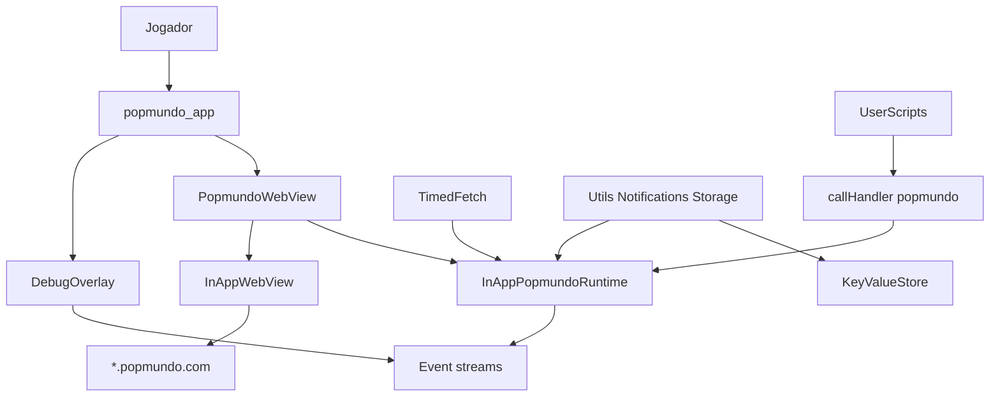

# Popmundo Wrapper Design

**Spec**: `.specs/features/popmundo-wrapper/spec.md`
**Status**: Approved

---

## Architecture Overview

Dois packages internos + um app. `popmundo_utils` é Dart puro: modelos, `PopmundoRuntime`, HostTracker, TimedFetch, storage, facades. `popmundo_webview` é o adapter Flutter (`InAppWebView` 6.x, UserScripts, CookieManager). `popmundo_app` faz composition root e o overlay de debug.

A página do jogo permanece a UI principal. Dart observa tráfego e oferece helpers; nunca muta request/response.



---

## Code Reuse Analysis

### Existing Components to Leverage

| Component | Location | How to Use |
| --------- | -------- | ---------- |
| Nenhum código Flutter no repo | workspace vazio | Greenfield |
| Popmundo-Utils `common/` | GitHub GPL-3 | Traduzir APIs; não copiar `chrome.*` |
| `flutter_inappwebview` 6.x | pub.dev | WebView, UserScripts, JS handlers, CookieManager |
| `shared_preferences` | pub.dev | Implementação de `KeyValueStore` no app |
| `url_launcher` | pub.dev | Links fora de popmundo.com |

### Integration Points

| System | Integration Method |
| ------ | ------------------ |
| Popmundo web | InAppWebView + cookies nativos |
| JS da página | `addJavaScriptHandler('popmundo')` + `evaluateJavascript` |
| Persistência local | `KeyValueStore` → `SharedPreferences` |

---

## Components

### HostTracker

- **Purpose**: Origem sticky do jogo (`https://www.popmundo.com` até o primeiro redirect).
- **Location**: `packages/popmundo_utils/lib/src/host_tracker.dart`
- **Interfaces**:
  - `Uri get currentOrigin`
  - `void onNavigation(Uri url)` — atualiza se `isPopmundoHost(url.host)`
  - `Uri resolve(String path)` — `https://{host}/{path}` com slashes normalizados
  - `static bool isPopmundoHost(String host)`
  - `static bool isPopmundoUri(Uri uri)`
- **Dependencies**: none
- **Reuses**: regra de `Utils.getServerLink`

### ObservePolicy

- **Purpose**: Decisão pura de navegação/interceptação (testável sem WebView).
- **Location**: `packages/popmundo_utils/lib/src/observe_policy.dart`
- **Interfaces**:
  - `enum NavDecision { allowInWebView, openExternal }`
  - `NavDecision decideNavigation(Uri uri)`
  - `Never replacementResponse` — helper `observeOnlyResourceResponse()` returns `null` (não substitui)
- **Dependencies**: HostTracker allowlist
- **Reuses**: none

### Event models + PopmundoEventBus

- **Purpose**: Streams de rede, console e navegação.
- **Location**: `packages/popmundo_utils/lib/src/events.dart`
- **Interfaces**:
  - `NetworkEvent({method, url, status, body, bodyTruncated, bodyOmitted, source})`
  - `ConsoleEvent({level, message})`
  - `NavigationEvent({url})`
  - `PopmundoEventBus` com `Stream<NetworkEvent> network`, etc., e `emit*`
  - `String? truncateBody(String? body, {int maxBytes = 32768})`
- **Dependencies**: none

### PopmundoRuntime

- **Purpose**: Contrato do adapter WebView para utils.
- **Location**: `packages/popmundo_utils/lib/src/popmundo_runtime.dart`
- **Interfaces**:
  - `HostTracker get host`
  - `PopmundoEventBus get events`
  - `Future<String?> evaluate(String source)`
  - `Future<InPageFetchResult> fetchInPage({required String url, Map? options})`
  - `Future<void> waitUntilReady({Duration timeout})`
- **Dependencies**: HostTracker, events
- **Reuses**: none

### TimedFetch

- **Purpose**: Fila serial, delay 750 ms, cache `METHOD:URL`, fetch in-page.
- **Location**: `packages/popmundo_utils/lib/src/timed_fetch.dart`
- **Interfaces**:
  - `TimedFetch(PopmundoRuntime runtime, {Duration delay, Clock? clock})`
  - `Future<String> fetch(String resource, {Map options, bool useCache = true})`
- **Dependencies**: Runtime, HostTracker for relative URLs
- **Reuses**: semântica do TimedFetch JS original

### StorageService + KeyValueStore

- **Purpose**: Substituto de `chrome.storage` para exclude lists e opções.
- **Location**: `packages/popmundo_utils/lib/src/storage.dart`
- **Interfaces**:
  - `KeyValueStore` get/set/remove JSON-encodable maps
  - `MemoryKeyValueStore` para testes
  - `getExcludedIds`, `toggleExclusion`, `normalizeExcludeMap`, `excludeEntryId`, `cacheCharName`, `loadSyncedCharNames`
- **Dependencies**: none (sem shared_preferences no package utils)
- **Reuses**: chaves lógicas da extensão

### Utils / Notifications / CssSelector / Scoring / Logger

- **Purpose**: Facades Dart que `evaluate` JS injetado ou usam TimedFetch.
- **Location**: `packages/popmundo_utils/lib/src/{utils,notifications,css_selector,scoring,logger}.dart`
- **Interfaces**: métodos alinhados ao spec (`getMyID`/`getMyName` via TimedFetch GET `/World/Popmundo.aspx/Character` + parse HTML, getServerLink, createNotification, getPageNotifications, applyScoringNumbers não auto-chamado)
- **Dependencies**: Runtime, TimedFetch, Storage
- **Reuses**: seletores e endpoints do `common/`

### InAppPopmundoRuntime + PopmundoWebView

- **Purpose**: Widget WebView + implementação do runtime.
- **Location**: `packages/popmundo_webview/lib/src/`
- **Interfaces**:
  - `PopmundoWebView({required PopmundoRuntimeBinder, initialUrl})`
  - Settings: `javaScriptEnabled: true`, `incognito: false`, `cacheEnabled: true`, `useShouldOverrideUrlLoading: true`, `useShouldInterceptAjaxRequest: true`, `useShouldInterceptFetchRequest: true`
  - `shouldInterceptFetchRequest` / `shouldInterceptAjaxRequest`: emitir evento se útil, **devolver o request inalterado**
  - `shouldInterceptRequest` (Android): **sempre `null`** (observe-only)
  - `shouldOverrideUrlLoading`: ALLOW popmundo, CANCEL + `url_launcher` externo
  - Handler `popmundo` recebe `{type, payload}`
- **Dependencies**: `popmundo_utils`, `flutter_inappwebview`, `url_launcher`
- **Reuses**: ObservePolicy, HostTracker, EventBus

### UserScripts

- **Purpose**: Wrap fetch/XHR/console; expor `window.__popmundo` helpers.
- **Location**: `packages/popmundo_webview/assets/js/`
- **Interfaces**:
  - `hooks.js` AT_DOCUMENT_START — originalFetch, hook, callHandler (queue until bridge ready)
  - `helpers.js` AT_DOCUMENT_END — getMyID, notifications DOM, css/xpath, scoring functions; **sem** auto-run Scoring
- **Dependencies**: flutter JS bridge
- **Reuses**: seletores do common/

### DebugOverlay + App

- **Purpose**: Shell fullscreen + painel recolhível.
- **Location**: `apps/popmundo_app/lib/`
- **Interfaces**: FAB; painel com host, network, console, eval, clear; cookies nomes sem valores
- **Dependencies**: webview package, utils, shared_preferences
- **Reuses**: EventBus

---

## Data Models (if applicable)

### NetworkEvent

```dart
class NetworkEvent {
  final String method;
  final String url;
  final int? status;
  final String? body;
  final bool bodyTruncated;
  final bool bodyOmitted;
  final String source; // fetch | xhr | native
  final DateTime at;
}
```

### InPageFetchResult

```dart
class InPageFetchResult {
  final bool ok;
  final int status;
  final String text;
}
```

### CharacterDetails

```dart
class CharacterDetails {
  final int id;
  final String name;
}
```

**Relationships**: TimedFetch produz `String` HTML/JSON; Notifications.parse usa o texto; HostTracker não persiste (só memória + cookies da WebView).

---

## Error Handling Strategy

| Error Scenario | Handling | User Impact |
| -------------- | -------- | ----------- |
| WebView onReceivedError | Mantém origin; Overlay/estado permite reload | Página de erro do WebView; app não crasha |
| JS bridge not ready | `waitUntilReady` timeout 30s → `PopmundoRuntimeException` | Helper falha; jogo continua |
| TimedFetch non-2xx | Completa com erro, não cacheia | Caller trata |
| Notification level inválido | Erro Dart | Overlay/console |
| Link externo | CANCEL + url_launcher | Abre fora do app |
| Popmundo down | onLoadError | Jogador recarrega |

---

## Risks & Concerns

| Concern | Location | Impact | Mitigation |
| ------- | -------- | ------ | ---------- |
| iOS sem shouldInterceptRequest | InAppWebView | Perde resources nativos (img/css) no stream | Hooks JS em fetch/XHR + console; spec não exige 100% de assets |
| POST body nativo Android incompleto | shouldInterceptRequest | Body vazio | Body vem do wrap JS de fetch/XHR |
| callHandler antes do bridge | hooks.js | Eventos perdidos no primeiro paint | Fila JS até `flutterInAppWebViewPlatformReady` |
| Throttle/logout | TimedFetch | Sessão cai | Fila serial 750 ms; helpers usam TimedFetch |
| Cookie values na UI | overlay | Vazamento de sessão | Nomes/domínios apenas |
| GPL-3 derivativo | packages | Licença do app | LICENSE + NOTICE |
| Testes sem device | webview | CI frágil | Lógica pura em utils; widget overlay com fake bus; sem e2e live |

---

## Tech Decisions (only non-obvious ones)

| Decision | Choice | Rationale |
| -------- | ------ | --------- |
| Utils sem Flutter | Dart package puro | Testes sem binding; `KeyValueStore` injetável |
| SharedPreferences no app | `SharedPreferencesKeyValueStore` | Implementação, não contrato |
| Não usar shouldInterceptRequest como fonte | Sempre return null no Android | Observe-only + paridade iOS |
| url_launcher para externo | CANCEL + launchUrl | Spec HOST-03 |
| Melos + pub workspace | `melos.yaml` na raiz | AD-001 |
| Handler único `popmundo` | `{type, payload}` | Um canal, tipos: `network`, `console` |
| Truncate 32768 | UTF-8 bytes via `utf8.encode` length | Spec INT-05 |

Project-level decisions already in `.specs/STATE.md` AD-001…AD-008. Nenhuma nova AD nesta rodada além das já gravadas na Specify.
