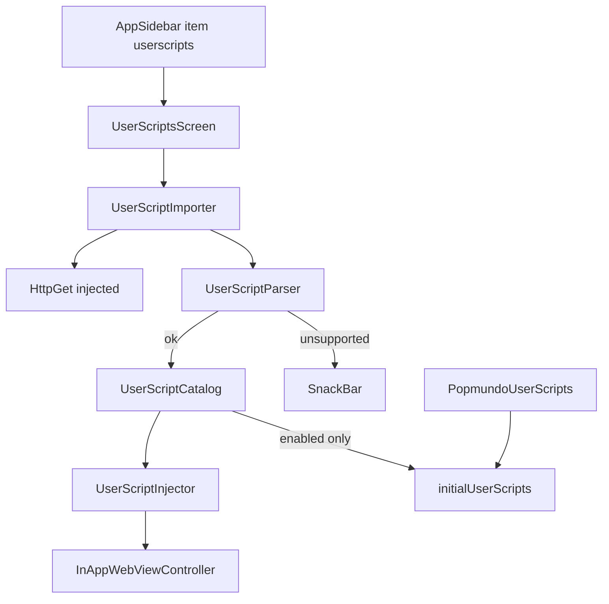

# UserScript Manager Design

**Spec**: `.specs/features/userscript-manager/spec.md`
**Status**: Approved

---

## Architecture Overview

Parser + catalog live in `popmundo_utils` (device-free tests). Injection lives in `popmundo_webview` (InAppWebView `UserScript` API). UI + HTTP live in `popmundo_app`. Built-in `hooks.js`/`helpers.js` remain owned by `PopmundoUserScripts`; user scripts use isolated `groupName`s and never call `removeAllUserScripts`.



## Code Reuse Analysis

### Existing Components to Leverage

- `KeyValueStore` / `SharedPreferencesStore` / `MemoryKeyValueStore` — persistence
- `buildAppMenuItems` — sidebar entry (AD-009)
- `PopmundoUserScripts.load()` — built-in scripts merged into `initialUserScripts`
- `InAppPopmundoRuntime.controller` — add/remove/reload
- `ThemeData` in `PopmundoApp` — unchanged

### Integration Points

- `PopmundoWebView` waits for built-in + enabled catalog scripts before creating `InAppWebView`
- `InAppPopmundoRuntime` gains `applyUserScriptCatalog` / reload helpers
- `PopmundoHome` wires catalog + importer + opens screen from menu callback

## Components

### UserScriptParser (`popmundo_utils`)

- Parse `==UserScript==` block; apply honor/reject matrix from spec
- Produce `ParsedUserScript` (name, runAt, noframes, match/include/exclude lists, requires, grants, metadata, body)
- `buildInjectableSource()` wraps body with match/include/exclude guards

### UserScriptCatalog (`popmundo_utils`)

- CRUD on `KeyValueStore` key `userscripts.v1`
- Fields: `id`, `sourceUrl`, `name`, `version`, `description`, `enabled`, `source`, `headers` (map), `installedAt`, injection fields (`runAt`, `forMainFrameOnly`, …)
- Dedup by `sourceUrl`; toggle; delete

### UserScriptImporter (`popmundo_utils`)

- `typedef UserScriptHttpGet = Future<String> Function(Uri url, {Duration? timeout})`
- Validate URL → GET → parse → fetch `@require`s in order → concat → `catalog.add`
- Any failure → zero writes; throw typed error with message for SnackBar

### UserScriptInjector (`popmundo_webview`)

- Map catalog entry → `flutter_inappwebview.UserScript` with `groupName: 'userscript:<id>'`
- `mergeInitial(builtin, enabledEntries)`
- `sync(controller, previousEnabledIds, nextCatalog)` → add/remove by group + `reload()`
- Never calls `removeAllUserScripts`

### UserScriptsScreen (`popmundo_app`)

- Scaffold + AppBar + ListView / empty state
- Add dialog (URL field); SwitchListTile; delete IconButton + AlertDialog; SnackBar
- No custom colors/fonts

## Data Models

```dart
class InstalledUserScript {
  final String id;
  final String sourceUrl;
  final String name;
  final String? version;
  final String? description;
  final bool enabled;
  final String source; // injectable (requires + guarded body)
  final Map<String, List<String>> headers;
  final DateTime installedAt;
  final UserScriptRunAt runAt; // documentStart | documentEnd
  final bool forMainFrameOnly;
}
```

## Tech Decisions

| Decision | Choice | Rationale |
| -------- | ------ | --------- |
| Persistence | `KeyValueStore` `userscripts.v1` | Existing storage seam |
| HTTP | Injected callback | Keeps utils free of `http`/`dart:io` |
| Injection API | `UserScript` only | Spec + docs; not evaluateJavascript for AT_DOCUMENT_START |
| Isolation | `groupName` | Preserve built-ins (AD-003 / AD-010) |

## Risks & Concerns

| Concern | Mitigation |
| ------- | ---------- |
| `removeAllUserScripts` wipes hooks | Injector API never exposes it; tests assert absence |
| Android AT_DOCUMENT_START best-effort | Same as built-in hooks; documented |
| Malicious remote JS | Accepted product risk; user-owned |
| WebView destroyed on route push | Use push on top of home that keeps WebView in tree under MaterialApp navigator — screen is pushed as sibling route; WebView state may dispose if home is replaced. Prefer pushing a route that does not replace `PopmundoHome` (standard `Navigator.push` from home keeps previous route in stack → WebView State preserved). |

## AD linkage

- AD-010 (new): user catalog persistence + `groupName` isolation; never `removeAllUserScripts` for this feature
