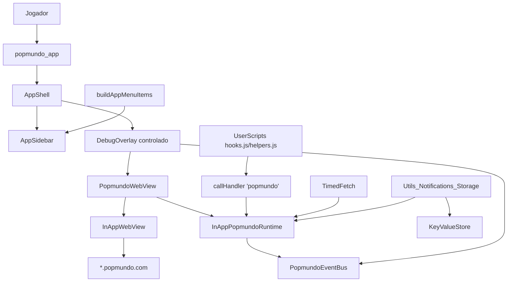

# Arquitetura do Sistema — Popflutter

> Documento gerado por análise estática do código-fonte real (imports, chamadas, configs) e dos artefatos de spec-driven development em `.specs/features/popmundo-wrapper/` e `.specs/STATE.md`. Onde a análise exigiu inferência sem confirmação direta no código, o trecho está marcado como **Hipótese**.
>
> Última atualização: 2026-08-17.

---

## 1. Visão arquitetural do projeto

Popflutter é um monorepo Flutter (workspace via `pubspec.yaml` + `melos.yaml`, ver `AD-001` em `.specs/STATE.md`) com três unidades de deploy/publicação:

```
apps/popmundo_app       -> shell Flutter (Android + iOS), composition root, overlay de debug
packages/popmundo_webview -> adapter Flutter para flutter_inappwebview + JS bridge
packages/popmundo_utils   -> Dart puro (sem Flutter), contrato + helpers
```

A UI principal do produto **é a própria página web do Popmundo**, renderizada dentro de um `InAppWebView`. O app Flutter não reimplementa a UI do jogo; ele:

1. hospeda o WebView em tela cheia;
2. observa (sem alterar) tráfego de rede, console e navegação da página;
3. expõe, em Dart, uma "fundação" de utilitários equivalente ao `common/` do projeto de referência [Popmundo-Utils](https://github.com/ilpersi/Popmundo-Utils) (GPL-3), para que features futuras possam ser construídas sem reimplementar a extensão Chrome original;
4. oferece um overlay de debug nativo (FAB + painel) para inspecionar host atual, eventos de rede/console e rodar `evaluateJavascript` ad-hoc.

A camada `popmundo_utils` é isolada do Flutter/WebView por um contrato (`PopmundoRuntime`), permitindo testar toda a lógica de negócio com um runtime falso, sem dispositivo/emulador.



---

## 2. Padrões utilizados

| Padrão | Onde | Evidência no código |
| ------ | ---- | -------------------- |
| **Porta/Adapter (Ports & Adapters)** | `PopmundoRuntime` (porta, em `popmundo_utils`) vs. `InAppPopmundoRuntime` (adapter, em `popmundo_webview`) | `packages/popmundo_utils/lib/src/popmundo_runtime.dart` declara a `abstract class`; `packages/popmundo_webview/lib/src/in_app_runtime.dart` implementa |
| **Composition root** | `apps/popmundo_app/lib/main.dart` monta `InAppPopmundoRuntime()` + `SharedPreferencesStore(prefs)` e injeta em `PopmundoApp` | Nenhum outro ponto do código instancia o runtime concreto |
| **Facade** | `Utils`, `Notifications`, `Scoring`, `CssSelectorHelper`, `XPathHelper` — encapsulam chamadas `runtime.evaluate(...)` para funções JS de `window.__popmundo.*` | `packages/popmundo_utils/lib/src/{utils,notifications,scoring,css_selector}.dart` |
| **Event Bus / Observer** | `PopmundoEventBus` com streams broadcast (`network`, `console`, `navigation`) | `packages/popmundo_utils/lib/src/events.dart` |
| **Repository mínimo / Strategy de storage** | `KeyValueStore` (contrato) → `MemoryKeyValueStore` (testes, em `popmundo_utils`) e `SharedPreferencesStore` (produção, em `popmundo_app`) | `packages/popmundo_utils/lib/src/storage.dart`, `apps/popmundo_app/lib/prefs_store.dart` |
| **Fila serial / rate limiter** | `TimedFetch` encadeia `Future` anterior + espera por `delay` antes de cada fetch | `packages/popmundo_utils/lib/src/timed_fetch.dart` |
| **Injeção de dependência manual (sem framework de DI)** | Construtores recebem `PopmundoRuntime`, `KeyValueStore`, `TimedFetch` explicitamente | Em todos os arquivos de `popmundo_utils` |
| **Fila de mensagens até bridge pronto (client-side buffering)** | `hooks.js` guarda mensagens em `queue` até `flutterInAppWebViewPlatformReady` disparar | `packages/popmundo_webview/assets/js/hooks.js:3-22` |
| **InheritedWidget para contexto compartilhado** | `PopmundoScope` expõe `runtime`/`storage` para a árvore de widgets do app | `apps/popmundo_app/lib/app.dart:89-112` |

---

## 3. Regras arquiteturais

Estas regras são impostas pelo código e/ou registradas como decisões em `.specs/STATE.md` (AD-001 a AD-008):

1. **`popmundo_utils` não pode depender de Flutter nem de `flutter_inappwebview`.** O `pubspec.yaml` do pacote não declara `flutter` como dependência; toda a lógica é testável com `dart test` puro (ver `packages/popmundo_utils/test/*`, todos usam `FakePopmundoRuntime`).
2. **Interceptação de rede é somente-observação.** `shouldInterceptFetchRequest`/`shouldInterceptAjaxRequest` sempre retornam o `request` original inalterado; `shouldInterceptRequest` (Android) sempre retorna `null` via `ObservePolicy.observeOnlyResourceResponse()`. Nenhum caminho do código constrói um `WebResourceResponse` substituto (AD-003).
3. **Host sticky nunca é hardcoded após o primeiro load.** `HostTracker` é a única fonte de verdade para o host atual; `TimedFetch._absoluteUrl` e `Utils.getServerLink` sempre resolvem contra `runtime.host.currentOrigin`/`resolve()`, nunca contra a string literal `www.popmundo.com` (AD-007).
4. **Sessão nunca é incógnita.** `PopmundoWebSettings.defaults()` fixa `incognito: false` (AD-004).
5. **Um único canal de comunicação JS→Dart.** Todo evento da página passa pelo handler nomeado `'popmundo'` com payload `{type, payload}`; o roteamento por `type` acontece em Dart (`PopmundoJsBridge.handle`), não em múltiplos handlers.
6. **`Scoring` nunca roda automaticamente no load da página.** `Scoring.autoApplyOnLoad` é uma constante `false` documentada; nenhum `UserScript` chama `applyScoringNumbers()` sozinho — é uma API que o desenvolvedor invoca.
7. **Licenciamento GPL-3 é uma restrição de arquitetura, não só legal.** Como os pacotes derivam de um port do `common/` do Popmundo-Utils (GPL-3), APIs `chrome.*` são reimplementadas em Dart do zero (nunca copiadas), e o repositório inteiro herda GPL-3.0-or-later (AD-005, ver `LICENSE`/`NOTICE`).
8. **Cookies nunca expõem valor na UI de debug.** `DebugOverlay`/`CookieSummary` só carregam `name`+`domain` (`apps/popmundo_app/lib/app.dart:53-67`), nunca `cookie.value`.
9. **Nenhum widget do shell nativo pode instalar um reconhecedor de gesto sobre a área do WebView.** `AppShell` fixa `drawerEnableOpenDragGesture: false` (AD-009) para que o gesto de abrir o `Drawer` arrastando da borda esquerda nunca capture toques horizontais destinados ao jogo — qualquer novo controle nativo sobre `PopmundoWebView` deve preservar essa regra.

---

## 4. Convenções técnicas

- **Nomenclatura de pacote interno**: `window.__popmundo` é o namespace JS único injetado por `helpers.js`/`hooks.js`; todas as facades Dart (`Utils`, `Notifications`, `CssSelectorHelper`, `Scoring`) chamam funções desse namespace via `runtime.evaluate('window.__popmundo.<fn>(...)')`.
- **Serialização JS↔Dart**: argumentos sempre passam por `jsonEncode`/`jsonDecode` explícito nas facades (nunca interpolação de string crua de valores do usuário), e.g. `notifications.dart:29-30`, `css_selector.dart:12-13`.
- **Testabilidade sem device**: todo pacote/app tem um "fake" de canto: `FakePopmundoRuntime` (`popmundo_utils/test/fake_runtime.dart`), `MemoryKeyValueStore` (produção, reaproveitada em testes), streams fake nos testes de widget do overlay.
- **Assets JS versionados como parte do pacote**: `hooks.js`/`helpers.js` ficam em `packages/popmundo_webview/assets/js/` e são declarados em `pubspec.yaml` (`flutter: assets:`), carregados com fallback de path (`user_scripts.dart:10-16`) para funcionar tanto consumido como dependência quanto dentro do próprio pacote (testes).
- **Convenção de `Key` do shell nativo**: kebab-case, prefixado pelo widget dono — `app-sidebar` (a `Drawer`), `menu-toggle` (o FAB que a abre), `menu-item-<id>` (um item por entrada de `buildAppMenuItems`), `menu-empty` (estado vazio do sidebar); `debug-panel`, `debug-host`, `debug-clear`, `debug-close`, `debug-eval-input`, `debug-eval-run`, `debug-eval-result` (o painel de debug, agora controlado por `visible`/`onClose` em vez de dono do próprio FAB).
- **Erros tipados por camada**: `PopmundoRuntimeException` (contrato/adapter), `TimedFetchException` (fila de fetch) — nunca `Exception` genérica nos pontos de falha esperados.
- **Workspace/versionamento**: `resolution: workspace` em todos os `pubspec.yaml`, coordenado pelo `pubspec.yaml`/`melos.yaml` da raiz (AD-001).

---

## 5. Separação de responsabilidades

| Módulo | Responsabilidade | Não faz |
| ------ | ----------------- | ------- |
| `packages/popmundo_utils` | Contrato `PopmundoRuntime`; regras de negócio puras (host sticky, throttle, storage, parsing de notificações, políticas de navegação); modelos de evento | Não sabe renderizar UI, não importa `flutter_inappwebview`, não persiste em disco por conta própria (delega a `KeyValueStore` injetado) |
| `packages/popmundo_webview` | Implementação concreta do runtime sobre `InAppWebView`; ponte JS↔Dart; injeção de `UserScripts`; política de settings do WebView; widget `PopmundoWebView` | Não define regras de negócio (host sticky, cache, storage) — reusa o que vem de `popmundo_utils`; não decide layout de app |
| `apps/popmundo_app` | Composition root (instancia runtime + store concretos); shell de UI (`MaterialApp`); menu lateral componentizado (`lib/menu/`); overlay de debug; leitura de cookies via `CookieManager` | Não implementa lógica de parsing/negócio (delega às facades de `popmundo_utils`); não deveria falar diretamente com `flutter_inappwebview` fora do que `PopmundoWebView`/`InAppPopmundoRuntime` expõem — mas hoje importa `CookieManager`/`WebUri` diretamente em `app.dart` (ver seção 7, acoplamento) |
| `packages/popmundo_webview/assets/js` | Hooks de `fetch`/`XHR`/`console` e helpers de DOM (`getMyID`, `createNotification`, seletores) executando **na página do jogo** | Não decide política de rede — só captura e repassa via `callHandler` |

---

## 6. Fluxo de comunicação entre módulos

### 6.1 Página → Dart (eventos observados)

```
página (fetch/XHR/console) 
  -> hooks.js intercepta e chama post({type, payload})
  -> window.flutter_inappwebview.callHandler('popmundo', msg)
  -> InAppPopmundoRuntime.attach() registrou addJavaScriptHandler('popmundo', bridge.handleArguments)
  -> PopmundoJsBridge.handle(message) roteia por 'type': 'ready' | 'network' | 'console'
  -> runtime.events.emitNetwork/emitConsole(...)
  -> PopmundoEventBus streams -> DebugOverlay (setState) e qualquer outro listener
```

Navegação segue caminho separado, via callbacks nativos do `InAppWebView` (`onLoadStart`, `onUpdateVisitedHistory`, `shouldOverrideUrlLoading`) chamando `runtime.onNativeNavigation(uri)` diretamente — **não** passa pelo handler JS `'popmundo'`.

### 6.2 Dart → página (comandos)

```
Utils/Notifications/Scoring/CssSelectorHelper
  -> runtime.evaluate('window.__popmundo.<fn>(args...)')
  -> InAppPopmundoRuntime.evaluate() chama controller.evaluateJavascript
  -> resultado (String/JSON) decodificado de volta em Dart
```

`TimedFetch`/`fetchInPage` usam um caminho paralelo com `callAsyncJavaScript`, chamando `window.__popmundo.fetch(url, options)` (que roda `fetch` real no contexto da página, preservando cookies/same-origin), e devolvem `{ok, status, text}`.

### 6.3 Prontidão do bridge

`hooks.js` enfileira mensagens até o evento `flutterInAppWebViewPlatformReady`; ao disparar, drena a fila e envia `{type: 'ready'}`, que completa `InAppPopmundoRuntime._ready`. `TimedFetch.fetch` e qualquer chamada que dependa do bridge aguardam `runtime.waitUntilReady(timeout: 30s)` antes de prosseguir; timeout lança `PopmundoRuntimeException`.

### 6.4 Origem sticky

`HostTracker.onNavigation(uri)` é chamado tanto pelos callbacks nativos de navegação quanto pelo fluxo de `shouldOverrideUrlLoading`; qualquer chamada subsequente de `TimedFetch`/`Utils.getServerLink` resolve contra `host.currentOrigin`, nunca contra a URL inicial fixa.

---

## 7. Dependências críticas

| Dependência | Tipo | Onde | Criticidade |
| ----------- | ---- | ---- | ----------- |
| `flutter_inappwebview: ^6.1.5` | pacote externo | `popmundo_webview`, `popmundo_app` | Alta — toda a superfície de WebView, cookies, JS bridge e interceptação depende da API 6.x; upgrade de major version pode quebrar `in_app_runtime.dart`, `popmundo_webview_widget.dart` e `web_settings.dart` simultaneamente |
| `popmundo_utils` → `popmundo_webview` → `popmundo_app` | dependência interna (path) | `pubspec.yaml` de cada pacote | Alta — cadeia estritamente unidirecional (ver AD-002); nenhuma dependência circular encontrada |
| `shared_preferences: ^2.5.3` | pacote externo | apenas `apps/popmundo_app` (`prefs_store.dart`) | Média — única implementação real de `KeyValueStore` em produção; se trocada, `SharedPreferencesStore` precisa ser reescrita, mas o contrato em `popmundo_utils` não muda |
| `url_launcher: ^6.3.1` | pacote externo | `popmundo_webview` (abrir links externos) | Média — se falhar silenciosamente, links fora de `*.popmundo.com` não abrem (sem fallback visível no código) |
| Endpoint `POST /WebServices/A/Open.asmx/GetPageNotifications` (site real) | dependência externa de domínio | `notifications.dart:48-60` | Alta — contrato JSON (`wrapper['d']`, `Status`/`Text`) é assumido a partir do `common/` original; qualquer mudança no backend do Popmundo quebra `parsePageNotifications` sem aviso em compile-time |
| Seletores DOM (`div.idHolder`, `#ppm-content > div.box.ofauto.charPresBox > h2`, `#notifications`, `a[href*="Scoring"]`, `div[class*="rogressBar"]`) | dependência externa de domínio | `packages/popmundo_webview/assets/js/helpers.js` | Alta — todo `getMyID`/`getMyName`/`createNotification`/`Scoring` depende de marcação HTML específica do site que o time não controla |

---

## 8. Riscos técnicos e acoplamentos importantes

Extraído de `.specs/features/popmundo-wrapper/design.md` ("Risks & Concerns") e confirmado/ampliado na leitura do código:

| Risco/acoplamento | Local | Impacto | Mitigação existente |
| ------------------ | ----- | ------- | -------------------- |
| iOS não tem `shouldInterceptRequest` nativo | `web_settings.dart` / `popmundo_webview_widget.dart` | Stream de rede não captura 100% dos resources nativos (imagens/CSS) no iOS como faria no Android | Hooks JS de `fetch`/`XHR`/`console` cobrem o que interessa ao produto (chamadas ao backend); spec não exige paridade total de assets |
| Body de POST nativo no Android é limitado em `shouldInterceptRequest` | Não é usado como fonte (sempre `null`) | N/A — decisão AD-003 já evita depender disso | Body vem sempre do wrap JS (`hooks.js` `captureBody`) |
| `callHandler` pode ser chamado antes do bridge existir | `hooks.js:1-22` | Eventos do primeiro paint poderiam se perder | Fila (`queue`) até `flutterInAppWebViewPlatformReady` |
| Acoplamento direto de `apps/popmundo_app/lib/app.dart` a `flutter_inappwebview` (`CookieManager`, `WebUri`) | `app.dart:53-67` | O app (camada de composição) importa a lib de terceiros diretamente em vez de passar só pelo `PopmundoWebView`/`InAppPopmundoRuntime` — quebra parcialmente a separação de responsabilidades da seção 5 | Nenhuma; é acoplamento real hoje. **Observação, não um bug.** |
| `StorageService.toggleExclusion` faz `int.parse(myCharKey)` sem tratamento de erro | `storage.dart:72` | `FormatException` não capturada se `myCharKey` não for numérico | Nenhuma validação de entrada visível; caller precisa garantir formato |
| `isInspectable: true` fixo em `PopmundoWebSettings.defaults()` | `web_settings.dart:12` | WebView inspecionável via Safari/Chrome DevTools também em builds de release, não só debug | Nenhuma flag de build (`kReleaseMode`) diferencia isso hoje — **Hipótese**: pode ser intencional dado que o app é declarado como "ferramenta de desenvolvedor" (`context.md`), mas aumenta a superfície de inspeção em produção |
| Parsing de `GetPageNotifications` assume forma exata da resposta ASP.NET (`{d: ...}`) | `notifications.dart:62-83` | Mudança no backend quebra silenciosamente (retorna notificação vazia default, não erro) | Fallback para `PageNotification(status: 'normal', text: '')` quando a forma não bate — falha silenciosa, não crash |
| Licença GPL-3 herdada (AD-005) | Todo o repositório | Não é possível relicenciar para MIT/Apache enquanto código derivado de `common/` existir | `LICENSE` + `NOTICE` no repositório |
| Testes sem device real (webview) | `packages/popmundo_webview/test/`, `.specs/spec.md` Out of Scope | CI não cobre e2e contra `www.popmundo.com` (instável, exige auth real, ToS) | Lógica de negócio isolada em `popmundo_utils` com fakes; widget tests do overlay usam streams fake |
| Cache do `TimedFetch` é só em memória de processo | `timed_fetch.dart:33` | Reinício do app perde cache; não é um risco de corretude, é trade-off documentado (AD-006) | Aceito por design — paridade com o comportamento do `TimedFetch` original em JS |

---

## 9. Diretrizes para futuras implementações

1. **Nunca adicionar lógica de negócio em `popmundo_webview` ou `apps/popmundo_app`.** Se uma nova regra não depende de `InAppWebView`/`Flutter`, ela pertence a `popmundo_utils` e deve ser testável via `FakePopmundoRuntime`.
2. **Toda nova função exposta à página deve seguir o padrão Facade + `window.__popmundo.*`.** Adicionar a função JS em `helpers.js` (ou `hooks.js` se for interceptação), depois um método Dart em `popmundo_utils` que chama `runtime.evaluate(...)` com `jsonEncode` nos argumentos.
3. **Não romper o contrato "observe-only".** Qualquer novo callback de interceptação deve retornar o request/response original ou `null`/`ALLOW`; nunca introduzir um `WebResourceResponse` customizado ou mutação de request.
4. **Não hardcodar `www.popmundo.com` ou qualquer host fixo fora de `HostTracker.defaultOrigin`.** Toda URL de chamada auxiliar deve passar por `host.resolve(...)` ou pelo `origin` corrente.
5. **Respeitar o rate limit do `TimedFetch`** para qualquer nova chamada de rede auxiliar ao jogo — não introduzir `fetch` paralelo fora da fila serial, sob risco de throttle/logout (AD-006).
6. **Features de gameplay da extensão original (mass interact, call friends, autograph collector etc.) estão fora de escopo** por decisão explícita registrada em `spec.md` ("Out of Scope") — não devem ser adicionadas a este produto sem uma nova rodada de spec.
7. **Manter a licença GPL-3.0-or-later** em qualquer novo arquivo derivado de `common/` do Popmundo-Utils; reescrever, nunca copiar, chamadas `chrome.*`.
8. **Cobrir nova lógica com teste unitário puro em `popmundo_utils`** antes de (ou em vez de) teste de widget/integração — é o padrão já estabelecido em todos os arquivos de `test/`.
9. **Se estender o app para importar `flutter_inappwebview` diretamente (como `app.dart` já faz para cookies)**, documentar a exceção — o padrão preferido é passar pelo `InAppPopmundoRuntime`/`PopmundoWebView`.
10. **Novo item de menu = uma entrada em `buildAppMenuItems`** (`apps/popmundo_app/lib/menu/app_menu_registry.dart`). Nunca hardcodar um item novo dentro de `AppSidebar`/`AppShell` — ambos derivam sua lista visível inteiramente do registro, o que é o que os mantém agnósticos do runtime e escaláveis sem mudança estrutural.
