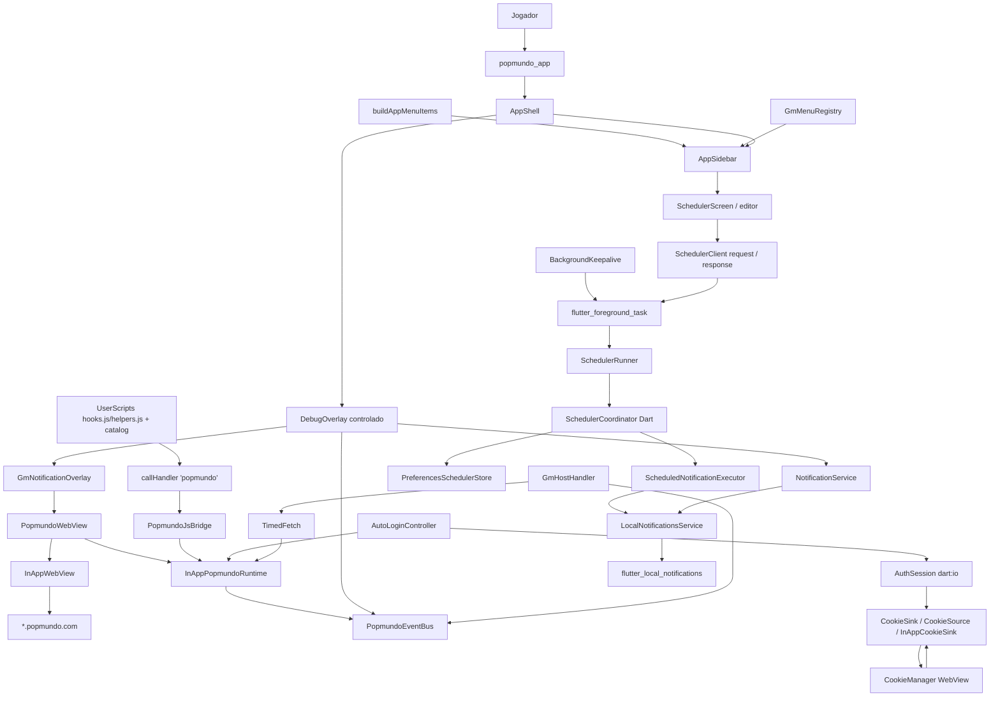

# Arquitetura do Sistema — Popflutter

> Documento gerado por análise estática do código-fonte real (imports, chamadas, configs) e dos artefatos em `.specs/STATE.md` e `.specs/features/`. Onde a análise exigiu inferência sem confirmação direta no código, o trecho está marcado como **Hipótese**.
>
> Última atualização: 2026-10-05.

---

## 1. Visão arquitetural do projeto

Popflutter é um monorepo Flutter (workspace via `pubspec.yaml` da raiz + `melos.yaml` só com globs de pacote, `AD-001`) com três unidades:

```
apps/popmundo_app        → shell Flutter (Android + iOS), composition root, UI nativa
packages/popmundo_webview → adapter Flutter para flutter_inappwebview + JS bridge
packages/popmundo_utils   → Dart puro (sem Flutter), contrato + regras de negócio
```

A UI principal do produto **é a própria página web do Popmundo**, renderizada dentro de um `InAppWebView`. O app Flutter não reimplementa a UI do jogo. Ele:

1. hospeda o WebView em tela cheia (`PopmundoWebView` dentro de `AppShell`);
2. observa (sem alterar) tráfego de rede, console e navegação da página;
3. persiste cookies da sessão (não incógnito) e, se configurado, reautentica em silêncio (Auto Login via HTTP nativo + sync de cookies);
4. injeta UserScripts do jogador e um polyfill `GM_*`/`GM.*`;
5. mantém um keepalive de processo em segundo plano (Foreground Service no Android);
6. agenda notificações locais Android por intervalos ou dias da semana, inclusive com o app fora da tela e após reboot enquanto existirem regras ativas (AD-021);
7. expõe, em Dart, uma fundação equivalente ao `common/` do [Popmundo-Utils](https://github.com/ilpersi/Popmundo-Utils) (GPL-3).

A camada `popmundo_utils` é isolada do Flutter/WebView pelo contrato `PopmundoRuntime`. Lógica de negócio é testável com `FakePopmundoRuntime`, sem dispositivo.



---

## 2. Padrões utilizados

| Padrão | Onde | Evidência no código |
| ------ | ---- | -------------------- |
| **Porta/Adapter** | `PopmundoRuntime` vs. `InAppPopmundoRuntime`; `CookieSink`/`CookieSource` vs. `InAppCookieSink`; `SecretStore` vs. `FlutterSecureSecretStore`; `KeyValueStore` vs. `SharedPreferencesStore` / `MemoryKeyValueStore`; `UserScriptWebViewPort` vs. `InAppUserScriptWebViewPort`; `BackgroundPlatform` vs. `FlutterForegroundTaskPlatform`; `NotificationService` vs. `LocalNotificationsService` / `FakeNotificationService` | Contratos em `popmundo_utils` (e `background_platform.dart`/`notifications/notification_service.dart` no app); implementações no adapter/app |
| **Composition root** | `apps/popmundo_app/lib/main.dart` monta um único `AppWiring` (runtime, store, keepalive, notificationService) e o entrega para `PopmundoApp`/`PopmundoHome`; `AppWiring` (não `PopmundoHome`) monta catalog, TimedFetch, AutoLogin, GM host e os demais 15 colaboradores (AD-022) | Nenhum outro ponto instancia `InAppPopmundoRuntime()`; `apps/popmundo_app/lib/app_wiring.dart` |
| **Facade** | `Notifications` / `Scoring` / `CssSelectorHelper` / `XPathHelper` — `runtime.evaluate('window.__popmundo.<fn>(...)')`; `Utils.getMyID`/`getMyName` — TimedFetch GET `/World/Popmundo.aspx/Character` + parse HTML | `packages/popmundo_utils/lib/src/facades/{utils,notifications,scoring,css_selector}.dart` |
| **Event Bus** | `PopmundoEventBus` com streams `network`, `console`, `navigation`, `gmValue`, `gmCall` | `packages/popmundo_utils/lib/src/core/events.dart` |
| **Fila serial / rate limiter** | `TimedFetch` (in-page) e `AuthSession` (HTTP nativo do Auto Login) — delay padrão 750 ms | `timed_fetch.dart`, `auth_http.dart` |
| **DI manual** | Construtores recebem portas explicitamente; sem framework de DI | Todo `popmundo_utils` e o composition root |
| **Buffer até bridge pronto** | `hooks.js` enfileira até `flutterInAppWebViewPlatformReady` | `packages/popmundo_webview/assets/js/hooks.js` |
| **Registro de menu** | `buildAppMenuItems` só preserva a ordem da lista recebida e anexa o item de debug por último quando o gate permite; cada feature dona seu próprio `AppMenuItem` (`autoLoginMenuItem`, `userscriptsMenuItem`, `languageMenuItem`, `debugMenuItem`) | `apps/popmundo_app/lib/menu/app_menu_registry.dart`; chamada única em `app.dart` (`build`) |
| **Polyfill por prelude JS** | `UserScriptGmShim` gera closure por script; host APIs voltam pelo canal `type: 'gm'` | `userscript_gm_shim.dart`, `js_bridge.dart`, `gm_host_handler.dart` |

---

## 3. Regras arquiteturais

As regras do scheduler estão registradas no AD-021 e em .specs/features/service-scheduler/.
Registradas em `.specs/STATE.md` (AD-001 a AD-021; AD-011 e AD-017 **superseded**):

1. **`popmundo_utils` não depende de Flutter nem de `flutter_inappwebview`.** Pode usar Dart puro (timezone, `html`, `dart:io` só em `auth_http_io.dart`). Testes padrão: `dart test` (globa `test/`).
2. **Interceptação de rede é somente-observação (AD-003).** `shouldInterceptFetchRequest`/`shouldInterceptAjaxRequest` devolvem o request original; `shouldInterceptRequest` (Android) devolve `null` via `ObservePolicy.observeOnlyResourceResponse()`. Nenhum caminho constrói `WebResourceResponse` substituto.
3. **Host sticky nunca é hardcoded após o primeiro load (AD-007).** `HostTracker` é a fonte da origem; `TimedFetch` e `Utils.getServerLink` resolvem contra `currentOrigin`. Auto Login, depois do handshake, resolve contra o host em que o POST realmente aterrissou (`landed.finalUrl.host`), não contra um origin guardado (AD-018).
4. **Sessão nunca é incógnita (AD-004).** `PopmundoWebSettings.defaults()` fixa `incognito: false`.
5. **Um único canal JS→Dart.** Handler `'popmundo'`, payload `{type, payload}`. `type` ∈ `ready` \| `network` \| `console` \| `gmValue` \| `gm`. Navegação **não** passa por esse handler — vem de callbacks nativos (`onLoadStart`, `onUpdateVisitedHistory`, `shouldOverrideUrlLoading`).
6. **`Scoring` nunca auto-roda no load.** `Scoring.autoApplyOnLoad` é `false`.
7. **GPL-3.0-or-later (AD-005).** Equivalentes de `chrome.*` são reimplementados em Dart, nunca copiados.
8. **Cookies nunca expõem valor na UI de debug.** Overlay mostra `name@domain`.
9. **Nenhum gesto nativo sobre a área do WebView (AD-009).** `AppShell` fixa `drawerEnableOpenDragGesture: false`.
10. **UserScripts do jogador nunca chamam `removeAllUserScripts` (AD-010).** Grupos `userscript:<id>`; builtins `hooks.js`/`helpers.js` permanecem.
11. **Download de `.user.js` / `@require` / `@resource` não usa TimedFetch (AD-010).** Fetcher HTTP do app (`userscript_http.dart`).
12. **FGS não toca WebView, JS, autenticação ou HTTP do jogo (AD-021).** Além do heartbeat, executa o scheduler de serviços locais. stopWithTask permanece false; boot e atualização do pacote retomam o serviço somente enquanto houver regras ativas.
13. **i18n da shell (AD-014).** `easy_localization`, catálogos `en`/`pt`. `popmundo_utils`/`popmundo_webview` e o DebugOverlay permanecem em inglês — inclui o título/corpo fixos da notificação de teste do debug (`LocalNotificationsService`, `kTestNotificationTitle`/`kTestNotificationBody`), que reusa a mesma exceção por só ser alcançável pelo botão debug-only.
14. **Dois tiers de teste no app (AD-015).** `flutter test` (fakes) vs. Patrol em `integration_test/` (device-real, **nunca** carrega popmundo.com). Exatamente um `patrolTest` por arquivo.
15. **Auto Login autentica fora da WebView (AD-018).** `AuthSession` em `dart:io`, redirects manuais, cookies copiados via `CookieSink`. Sem fallback de `form.submit()`. Observe-only (AD-003) permanece.
16. **Heartbeat de sessão (AD-019).** GET nativo 60 s em `{N.popmundo.com}/World/Popmundo.aspx/Character` com jar da WebView (`CookieSource`); 302 para login dispara AD-018. Timer no isolate do app; FGS não fala com o jogo.
17. **Senha só em `SecretStore`.** Settings não-secretos em `autologin.v1`. Nunca gravar senha em `KeyValueStore`.
18. **System-back consome histórico do WebView** antes de sair do app (`WebViewBackHandler` + `PopScope` em `PopmundoWebView`).

---

## 4. Convenções técnicas

- **Namespace JS:** `window.__popmundo` (`helpers.js` DOM/QoL; `hooks.js` interceptação, `fetch`, `gmReply`).
- **Serialização JS↔Dart:** `jsonEncode`/`jsonDecode` nas facades; sem interpolar input cru em JS.
- **Fakes por camada:** `FakePopmundoRuntime`, `MemoryKeyValueStore`, `MemorySecretStore`, `MemoryCookieSink`, `FakeBackgroundPlatform`.
- **Assets JS** em `packages/popmundo_webview/assets/js/`, com fallback de path em `user_scripts.dart`.
- **Keys de widget:** kebab-case (`menu-toggle`, `menu-item-<id>`, `debug-panel`, `debug-send-notification`, `autologin-status-<phase>`, `language-dialog`, …).
- **Erros tipados:** `PopmundoRuntimeException`, `TimedFetchException`, `AuthHttpException`, `UserScriptParseException`, `UserScriptImportException`, `UserScriptCatalogException`.
- **Workspace:** `resolution: workspace` em todos os `pubspec.yaml`. `melos.yaml` só lista globs — **não há scripts Melos**.
- **Chaves de storage (produção, via `KeyValueStore`):** `userscripts.v1`, `autologin.v1`, `userscript:<id>:gmvalues`, `userscript:<id>:gmresources`. Senha: `autologin.password` no `SecretStore`.
- **Scheduler:** service_scheduler.v1 é um snapshot JSON único, com um escritor no engine FGS. A UI não grava esse blob.
- **UserScripts nativos:** `groupName: 'userscript:<id>'`, `ContentWorld.PAGE`.

---

## 5. Separação de responsabilidades

| Módulo | Responsabilidade | Não faz |
| ------ | ----------------- | ------- |
| packages/popmundo_utils | Contrato PopmundoRuntime; host, fetch, Auto Login, UserScripts/GM, eventos e scheduler com modelos/calendário/coordenador | Sem Flutter, UI ou plugins; persistência, ação nativa e fuso são portas injetadas |
| `packages/popmundo_webview` | `InAppPopmundoRuntime`; widget `PopmundoWebView`; JS bridge; UserScripts builtins + injector; `InAppCookieSink`; back navigation; settings do WebView | Não decide throttle, parsing de login, catálogo persistido, i18n, FGS |
| `apps/popmundo_app` | Composition root (`AppWiring`); shell (`AppShell`/sidebar); telas Auto Login / UserScripts / Agendamentos / idioma; `GmHostHandler`; keepalive; adapters de persistência, fuso e notificações; i18n; `SharedPreferencesStore` / `FlutterSecureSecretStore` | Não implementa parsing de form ASP.NET, calendário nem política de host; **ainda** importa `flutter_inappwebview` em `cookie_watcher.dart` para ler nomes de cookies; WebView e HTTP do jogo não rodam no engine FGS |
| `packages/popmundo_webview/assets/js` | Hooks de `fetch`/`XHR`/`console` e helpers DOM **na página** | Não decide política — só captura e `callHandler` |
| `apps/popmundo_app/integration_test` | Tier device-real (Patrol): FGS, Keystore, prefs, sockets loopback | Não constrói `PopmundoApp` / `InAppPopmundoRuntime`; não carrega o jogo |
| `packages/popmundo_utils/test_live` | Suite **opt-in** contra o site real (credenciais em env); `dart test` **não** a executa | Não substitui o tier fake; não é CI |

---

## 6. Fluxo de comunicação entre módulos

### 6.1 Página → Dart (eventos observados)

```
página (fetch/XHR/console/GM)
  → hooks.js post({type, payload})  [fila até flutterInAppWebViewPlatformReady]
  → callHandler('popmundo', msg)
  → PopmundoJsBridge.handle  type: ready | network | console | gmValue | gm
  → PopmundoEventBus
  → DebugOverlay / GmValueStore.applyEvent / GmHostHandler.handle
```

Navegação: callbacks nativos → `InAppPopmundoRuntime.onNativeNavigation` → `HostTracker.onNavigation` + `events.emitNavigation`. Auto Login e o sidebar GM escutam esse stream (GM limpa comandos a cada navegação).

### 6.2 Dart → página (comandos)

```
Notifications / Scoring / CssSelectorHelper
  → runtime.evaluate('window.__popmundo.<fn>(...)')
Utils.getMyID / getMyName / getMyCharDetails
  → TimedFetch GET `/World/Popmundo.aspx/Character` (cache METHOD:URL) → parse `div.idHolder` / `#ppm-content > div.box.ofauto.charPresBox > h2`
TimedFetch / fetchInPage
  → callAsyncJavaScript → window.__popmundo.fetch (fetch real na página)
GM host reply
  → runtime.evaluate('window.__popmundo.gmReply(...)')
Navegação de documento
  → runtime.loadUrl(uri)  (WebView.loadUrl)
```

### 6.3 Auto Login (AD-018 + AD-019)

```
gatilho A: navegação para / ou /Default.aspx
gatilho B: a cada 60 s, GET nativo {hostSticky}/World/Popmundo.aspx/Character
           (sem seguir redirect; cookies da WebView via CookieSource)
           302 Location /Default.aspx ⇒ mesmo ciclo
           200 / rede / 5xx / host www ⇒ no-op
  → AutoLoginController (enabled + credenciais, inFlight)
  → AuthSession (dart:io, followRedirects=false, cooldown 750 ms)
      GET form → POST #aspnetForm inteiro + overrides
      hop www → N.popmundo.com (Set-Cookie no último hop)
      POST ChooseCharacter (match por <h2> nome completo)
  → CookieSink.write(jar) → CookieManager da WebView
  → AutoLoginStatus(done) → snackbar EN/PT ou notificação local id 2 em background
  → runtime.loadUrl(https://{host_final}/World/Popmundo.aspx), espera limitada a 2 s
```

O User-Agent é resolvido pela API nativa Android no app e cacheado com timeout de 2 s; clientes sem provider usam captura inicial de navigator.userAgent com o mesmo limite. Probes seguintes não aguardam JS. O isolate FGS executa heartbeat e serviços locais (AD-021); o Auto Login permanece no isolate do app.

### 6.4 UserScripts + GM

```
UserScriptsScreen → UserScriptImporter (HTTP app, não TimedFetch)
  → UserScriptCatalog (userscripts.v1)
  → InAppPopmundoRuntime.syncUserScripts → UserScriptInjector (add/remove por groupName + reload)
GM_setValue na página → type gmValue → GmValueStore
GM.xmlHttpRequest / openInTab / … → type gm → GmHostHandler
  Popmundo URLs: TimedFetch; terceiros: HttpClient sem cookies do jogo; @connect em runtime
GM.registerMenuCommand → GmMenuRegistry → seção extra no AppSidebar (limpa na navegação)
```

### 6.5 Keepalive

main() inicializa a porta de comunicação. BackgroundKeepalive.bootstrap() pede notificação e isenção de bateria no Android e sobe o FGS specialUse. KeepaliveTaskHandler mantém o heartbeat e cria SchedulerRunner no engine do serviço; WebView, autenticação e HTTP do jogo ficam fora desse engine. Os flags de boot e atualização do pacote derivam das regras ativas, sem parar o keepalive ao pausar ou excluir a última regra.

### 6.6 Notificação de teste local (debug)

```
main() → LocalNotificationsService().initialize() (antes do runApp; erro é capturado, nunca propaga)
DebugOverlay botão 'debug-send-notification' → _sendTestNotification()
  → NotificationService.requestPermission()
      concedida ⇒ NotificationService.showTestNotification() → tray do SO
      negada    ⇒ no-op; painel permanece interativo
```

`apps/popmundo_app/lib/notifications/` — `NotificationService` (contrato), `LocalNotificationsService` (única classe que importa `flutter_local_notifications`; canal fixo `popflutter_debug_channel`, id fixo, título/corpo fixos em inglês), `FakeNotificationService` (dublê do tier rápido). Instanciado e inicializado em `main.dart` junto do `keepalive`, encaminhado por `PopmundoApp`/`PopmundoHome` até `DebugOverlay` como parâmetro opcional (`notificationService`). Sem lifecycle contínuo (ao contrário do `BackgroundKeepalive`): é uma ação única disparada manualmente, debug-only (herda o gate do sidebar, AD-009), sem toque na WebView/TimedFetch e sem gatilho de gameplay (fora de escopo). Prova de plumbing real fica no tier device-real (`integration_test/notifications_test.dart`), já que o canal de plugin não roda sob `flutter test`.

---

## 7. Dependências críticas

| Dependência | Tipo | Onde | Criticidade |
| ----------- | ---- | ---- | ----------- |
| `flutter_inappwebview: ^6.1.5` | pub.dev | `popmundo_webview`, `popmundo_app` | Alta — WebView, cookies, UserScripts, JS handler |
| `popmundo_utils` → `popmundo_webview` → `popmundo_app` | path | pubspecs | Alta — cadeia unidirecional (AD-002); sem ciclo encontrado |
| `html: ^0.15.6` | pub.dev | `popmundo_utils` | Alta para Auto Login — parse de `#aspnetForm` / `div.box` |
| `shared_preferences: ^2.5.3` | pub.dev | app | Média — `KeyValueStore` de produção |
| `flutter_secure_storage: ^9.2.4` | pub.dev | app | Alta para Auto Login — senha |
| `flutter_foreground_task: ^11.0.0` | pub.dev | app | Alta para keepalive Android (`specialUse`, `stopWithTask=false`) |
| `flutter_local_notifications: ^22.3.0` | pub.dev | app | Alta — ações do scheduler, botão de teste do debug overlay e as notificações reais de `MenuNotificationsBridge` (`LocalNotificationsService`), incluindo resultados finais de Auto Login |
| timezone: ^0.11.1 / flutter_timezone | pub.dev | utils / app | Alta para recorrência semanal — banco IANA e identificador do fuso do dispositivo |
| `easy_localization: ^3.0.8` | pub.dev | app | Média — strings de release da shell |
| `url_launcher: ^6.3.1` | pub.dev | webview + app | Média — links externos e `GM.openInTab` |
| `patrol: ^4.9.0` + `patrol_cli` | pub.dev / global | app `dev_dependencies` | Média — só o tier device-real |
| `POST /WebServices/A/Open.asmx/GetPageNotifications` | domínio | `notifications.dart` | Alta para a facade Notifications; **o Auto Login atual não chama este endpoint** (veredicto de escolha = path ainda em ChooseCharacter) |
| `POST /WebServices/A/Open.asmx/GetMenuNotificationCount` (observado, nunca chamado pelo app) / `GetMenuNotifications` (chamado via `TimedFetch`) | domínio | `menu_notifications/` | Alta — `MenuNotificationsWatcher` reage ao `NetworkEvent` da própria contagem que o jogo já poll a sozinho; ao mudar, busca a lista e emite só itens novos (dedupe por `UID`, persistido via `KeyValueStore`) |
| Formulário ASP.NET (`#aspnetForm`, `ucLogin`, ChooseCharacter `div.box > h2`) | domínio | `autologin/` | Alta — Auto Login |
| Seletores DOM em `helpers.js` e no parse Dart de `/World/Popmundo.aspx/Character` | domínio | `Utils.getMyID` / `getMyName` / Scoring | Alta — o time não controla o HTML do jogo |

`dart:io` em `popmundo_utils` está **confinado** a `auth_http_io.dart` (transporte real do handshake). O restante do Auto Login injeta `AuthHttpSend` nos testes.

---

## 8. Riscos técnicos e acoplamentos importantes

| Risco/acoplamento | Local | Impacto | Mitigação existente |
| ------------------ | ----- | ------- | -------------------- |
| iOS sem `shouldInterceptRequest` nativo | `web_settings.dart` / widget | Stream de assets nativos incompleto no iOS | Hooks JS cobrem fetch/XHR/console |
| `cookie_watcher.dart` importa `CookieManager`/`WebUri` | `apps/popmundo_app/lib/cookie_watcher.dart` | Shell acoplada ao plugin, fora do adapter | Documentado; overlay só lê name+domain |
| `app` também importa `url_launcher` | `gm_host_handler.dart` | Segunda call site além de `popmundo_webview` | `GM.openInTab` vive no app porque usa clipboard/UI |
| Cookie sync nativo ↔ WebView | `InAppCookieSink` | Sessão "quase" válida se host-only ganhar `domain=` | Testes de `GameCookie` + `gameCookieFromInApp`; write omite `domain` quando o servidor não enviou; read trata domain=host como host-only |
| Cliente HTTP fora do browser | `AuthSession` | Servidor pode distinguir o handshake da WebView | Escolha explícita (AD-018); UA copiado da WebView |
| `isInspectable: true` fixo | `web_settings.dart` | DevTools também em release | Nenhuma flag `kReleaseMode`. **Hipótese:** aceitável por ser ferramenta de desenvolvedor |
| `StorageService.toggleExclusion` → `int.parse` | `storage.dart` | `FormatException` se a chave não for numérica | Sem validação no pacote |
| `Notifications.parsePageNotifications` | `notifications.dart` | Backend muda → fallback silencioso para notificação vazia | Não usado pelo Auto Login atual |
| `MenuNotificationsWatcher` reentrância | `menu_notifications/menu_notifications_watcher.dart` | Uma segunda mudança de contagem chegando enquanto um fetch está em voo é descartada, não enfileirada | Aceito — o jogo repoll a contagem sozinho, então o próximo poll recupera o estado real |
| Hash GUID→int para id de notificação | `apps/popmundo_app/lib/notifications/menu_notifications_bridge.dart` | Colisão teórica entre dois `UID`s distintos (espaço de 31 bits) | Aceito — dedupe real depende do `Set<String>` persistido, não do hash |
| GPL-3 herdada | repositório | Sem relicenciar enquanto houver código derivado | `LICENSE` / `NOTICE` |
| Patrol: um teste Dart por processo | `integration_test/` | Segundo `patrolTest` no mesmo arquivo falha 500 | Um `patrolTest` por arquivo (AD-015) |
| `test_live/` vs. política "sem e2e live" | `packages/popmundo_utils/test_live` | Suite opt-in **acessa** popmundo.com com credenciais de env; o `dart test` padrão **não** a inclui (`dart_test.yaml` globa só `test/`) | Não é CI; `.env` / `.envexample` não devem ser commitados com segredos. **Hipótese:** `.envexample` usa `TEST_*` enquanto o código lê `POPMUNDO_*` — nomes divergem |
| `gm-host-apis` sem `validation.md` | `.specs/features/gm-host-apis/` | Só `spec.md` + `context.md`; Handoff pede smoke em device com `.user.js` real | Código e testes unitários existem; Verifier da feature não está no repo |
| Spec Auto Login (Goals) ainda cita TimedFetch | `.specs/features/auto-login/spec.md` | Drift spec vs. AD-018 / controller | Resolvido no heartbeat: Goals citam `AuthSession` |
| `packages/popmundo_utils/example/` | example | `main` só imprime `HostTracker.defaultOrigin` | Boilerplate; não é ponto de entrada do produto |
| Cache TimedFetch só em memória | `timed_fetch.dart` | Perde ao matar o processo | AD-006, aceito |
| Retenção do processo Android / iOS suspende JS | keepalive / scheduler | Force-stop impede retomada automática; reboot restaura apenas regras locais ativas, sem restaurar Auto Login no novo engine | specialUse, flags condicionais e próximo horário estritamente futuro; segundos em melhor esforço |

---

## 9. Diretrizes para futuras implementações

1. **Lógica de negócio nova vai para `popmundo_utils`**, testável com fakes. UI/plugin Flutter fica no app; adapter WebView só transporta.
2. **Função de página = `window.__popmundo.*` + facade Dart com `jsonEncode`.**
3. **Não romper observe-only (AD-003).**
4. **Não hardcodar `www.popmundo.com` fora de `HostTracker.defaultOrigin`.**
5. **Chamada auxiliar same-origin ao jogo passa por TimedFetch (750 ms).** Handshake de login é a exceção documentada (AD-018) e replica o cooldown em `AuthSession`.
6. **Gameplay da extensão original (mass interact, call friends, etc.) continua fora de escopo** até nova spec.
7. **GPL-3.0-or-later**; não copiar `chrome.*`.
8. **Item de menu nativo = função `AppMenuItem` na pasta da própria feature + uma linha na lista `items:` em `app.dart`.** `buildAppMenuItems` só ordena e aplica o gate do item de debug. Comandos GM são dinâmicos (`GmMenuRegistry`), limpos na navegação — não misturar os dois.
9. **UserScript: nunca `removeAllUserScripts`.** Só `userscript:<id>`.
10. **String de UI de release no app passa pelos catálogos EN/PT.** Overlay de debug permanece em inglês.
11. **Patrol: um `patrolTest` por arquivo; harness mínimo; analyze antes do device.**
12. **Senha nunca em `KeyValueStore`.**
13. **Após mudança relevante, atualizar `docs/ARQUITETURA.md`, `docs/OBJETIVO.md` e o README do módulo** (ver `CLAUDE.md`, *Documentation maintenance*). Specs da feature em `.specs/features/<id>/` acompanham o comportamento real — se o código divergir, atualize o spec ou registre SPEC_DEVIATION; não deixe Goals obsoletos.

---

## 10. Mapa de features Spec Driven

| Feature `.specs/features/` | Pacotes tocados | Decisão |
| --------------------------- | --------------- | ------- |
| `popmundo-wrapper` | utils, webview, app | AD-001…008 |
| `app-sidebar-menu` | app | AD-009 |
| `userscript-manager` | utils, webview, app | AD-010 |
| `auto-login` | utils, webview, app | AD-018, AD-019 (AD-011/017 superseded) |
| background-session-reliability | utils, webview, app | AD-020 |
| `background-keepalive` | app | AD-012, AD-013 |
| `app-i18n` | app | AD-014 |
| `mobile-e2e-tests` | app `integration_test/` | AD-015 |
| `gm-host-apis` | utils, webview, app | AD-016 |
| `webview-back-navigation` | webview | — |
| service-scheduler | utils, app | AD-021 |

Fonte de *porquê*: `.specs/STATE.md` Decisions. Fonte de *o quê* por feature: `spec.md` da pasta. Este documento descreve o sistema **como o código está hoje**.

### Background reliability (AD-020)

A shell fornece getDefaultUserAgent da API nativa; o controller cacheia essa leitura com timeout de 2 s e fallback existente. Clientes sem provider usam uma captura inicial do bridge. Probes nativos usam esse cache e cookies nativos, sem esperar JS pronto a cada tick. Após sync dos cookies, o resultado do login é emitido; navegação é solicitada com espera limitada de 2 s para não prender o ciclo ao renderer suspenso. A shell publica notificação local id 2 para done/failed quando lifecycle não é resumed, com as mensagens EN/PT existentes. FGS specialUse declara manutenção contínua de sessão no subtype; force-stop e morte do processo permanecem limites da sessão; regras locais ativas podem restaurar o FGS após reboot (AD-021).

Se o handshake atribui outro servidor enquanto a navegação final está pendente, o controller guarda apenas para HTTP/cookies o origin recém-autenticado. HostTracker continua acompanhando navegações reais; callback de login obsoleto no servidor anterior não dispara novo ciclo. Nova navegação real devolve a autoridade ao HostTracker. Isso evita probes repetidos no servidor expirado antes de reabrir o app.

### Agendamentos locais (AD-021)

Sidebar → SchedulerClient → mensagem scheduler.request com requestId → SchedulerRunner no engine FGS → SchedulerCoordinator → PreferencesSchedulerStore. A resposta scheduler.response contém snapshot autoritativo ou erro tipado. Somente esse coordenador grava o blob service_scheduler.v1; a UI envia comandos com revisão esperada. O store recarrega preferências antes de ler e verifica a confirmação da gravação.
Enquanto visível e ativa, a lista consulta o catálogo a cada cinco segundos, agregando leituras em andamento e suspendendo-as durante edição ou lifecycle inativo. A primeira requisição espera um heartbeat do engine, pois serviço nativo iniciado ainda pode estar registrando o canal Dart. Essa espera é limitada e não repete comandos de mutação.

RecurrenceCalculator usa intervalos ancorados em UTC (dia = 24 horas decorridas) e calendário semanal no fuso IANA atual do dispositivo, obtido por flutter_timezone. Na transição de horário de verão, horários inexistentes avançam pelo tamanho do salto; horários repetidos usam somente a primeira ocorrência. DeviceZone limita a leitura nativa e retém o último identificador válido, sem assumir UTC quando indisponível. Mudanças de fuso são reconciliadas nos heartbeats de cinco segundos.
O engine carrega timezone/data/latest_all.dart, incluindo aliases IANA como GMT e UTC que podem ser retornados pelo Android; o banco reduzido não inclui todos esses identificadores.

O runner arma um único Timer para o horário mais próximo e agrega ticks sobrepostos na mesma fila dos comandos. Antes da ação, o coordenador persiste claim, lastAttemptUtc e próximo horário. Depois grava o resultado: solicitação submetida ao SO, falha ou interrupção. A execução tem limite de cinco segundos. Uma queda após claim pode perder a notificação, mas não repete a tentativa; o cursor impede repetição se o relógio retroceder. Ao iniciar um novo engine, todas as ocorrências vencidas são descartadas, aguardando a próxima estritamente futura. Snapshot inválido permanece preservado e indisponível, sem reset silencioso.
Falhas temporárias na criação do runner são tentadas novamente por heartbeat ou RPC. O prazo de cinco segundos limita a resposta, enquanto a inicialização subjacente mantém a posse exclusiva; um resultado tardio após destruição é descartado.

ScheduledNotificationExecutor chama o caminho estrito showScheduledNotification de LocalNotificationsService: inicialização e permissão precisam ser confirmadas; falhas são registradas. Cada regra tem ID negativo int32 estável e monotônico, sem reciclagem. Repetir substitui seu cartão; regras diferentes e os consumidores existentes de IDs positivos permanecem separados. O canal nativo é popflutter_schedules. Submetida significa aceitação da chamada do SO, sem garantia de leitura pelo usuário.
A ativação consulta areNotificationsEnabled do plugin de notificações pelo applicationContext; a consulta de permissões do ForegroundTask exige Activity e fica restrita ao isolate da tela. O engine secundário nunca abre pedidos de permissão.

O MVP é Android e somente notificação local. Há restauração após reboot e atualização do pacote enquanto existir regra ativa, sem recuperar horários perdidos. Force-stop bloqueia a execução até o usuário abrir o app; intervalos de segundos são melhor esforço diante das políticas do Android. iOS mostra indisponibilidade do scheduler contínuo. Reboot do serviço local não restaura o AutoLoginController do isolate principal.
